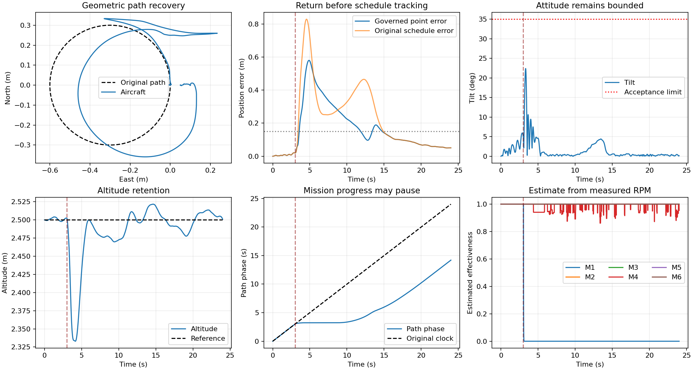

# 当前设计与代码总览

发布整理日期：2026-10-25。分支：`codex/current-design-and-recovery`。

本分支包含当前工作目录中维护的设计文档、Python 实现、Simulink 源码与可运行模型、测试及验证摘要。原始数据集、训练权重、大批运行输出和编译缓存保留在本地，不进入源码仓库。

## 1. 先看哪一部分

| 内容 | 入口 | 当前状态 |
|---|---|---|
| 单电机失效后的稳定与轨迹恢复 | [恢复设计与整定](simulink/validation/RECOVERY_TUNING.md)、[验证结果](simulink/validation/RECOVERY_SUMMARY.md) | 当前研究模型的 106 个实际 SLX 工况通过稳定与返回验收 |
| 恢复版 Simulink 模型 | [hex_recovery.slx](simulink/hex_recovery.slx)、[参数](simulink/hex_recovery_parameters.m) | 保存的默认示例为 1 号电机在 3 s 时完全失效，带噪声、风和 30 ms 反馈延迟 |
| 保留的健康基准/原任务模型 | [hex_evtol.slx](simulink/hex_evtol.slx)、[Simulink 说明](simulink/README.md) | 保留原模型、参数与历史分阶段验证 |
| Python 六旋翼仿真与故障诊断 | [main.py](main.py)、[运行顺序](RUNNING_ORDER.md)、[项目结构](PROJECT_STRUCTURE.md) | 19 类诊断管线；故障真值只作 plant/审计，不直接输入分类特征 |
| Python 物理参数及依据 | [参数源](hex_physical_characteristics.py)、[物理说明](docs/HEXAROTOR_PHYSICAL_CHARACTERISTICS.md) | 包含当前参数修正与明确标记的暂用参数 |
| UAV-FD/F550 独立实飞建模 | [独立模型说明](docs/uavfd_f550/README.md)、[状态](docs/uavfd_f550/MODEL_STATUS.md) | 数学检查通过；整体实飞模型尚未通过验证，最终测试集保持锁定 |
| 项目交接 | [PROJECT_HANDOFF.md](PROJECT_HANDOFF.md) | 区分恢复版、健康基准、独立实飞建模与历史诊断任务 |

这些实现的参数与验证目标分别记录，不能将 Simulink 的成功恢复结果解释为 F550 实飞模型验证通过。

## 2. 恢复版做了什么

目标顺序：稳定姿态和高度、返回原几何轨迹附近、再继续任务。三类故障是**单个电机**分别剩余 80%、20%、严格 0% 效能，六个电机逐一测试。

- [恢复控制器](simulink/blocks/recovery_controller_step.m)：根据转速观测与延迟对齐的历史命令估计电机响应比例，估计可用推力后进行有界分配；故障时降低航向优先级，并降低外环机动要求。
- [轨迹进度控制](simulink/blocks/recovery_reference_step.m)：位置偏差、倾角或滚转/俯仰角速度增大时减慢或暂停进度，恢复后继续原几何路径。
- [参数与增益](simulink/hex_recovery_parameters.m)：逐环比较后采用滚转/俯仰姿态增益 7，角速度比例增益 20；恢复阶段采用较缓的外环参数。
- [信息边界](simulink/hex_recovery_block_parameters.m)：控制和轨迹块不接收真实故障电机、效能或故障时刻。

估计器依赖转速反馈、已知反馈延迟以及当前“电机目标转速按比例下降”的故障模型。桨叶受损但转速正常等故障不在该估计器已验证的能力范围内。

## 3. MATLAB 使用

使用 MATLAB R2025b 与 Simulink。模型运行不依赖 Python、Optimization Toolbox 或 Aerospace Toolbox。

```matlab
cd('你的仓库目录/simulink')
open_hex_recovery

% 默认：圆轨迹、1号电机严格完全失效、噪声、风、30 ms延迟。
r=run_hex_recovery(Task="circle",FaultMotor=1,FaultFactor=0);

% 其他严重度和电机。
r=run_hex_recovery(Task="line",FaultMotor=4,FaultFactor=.2);
```

恢复版默认仿真 24 秒，第 3 秒注入故障。常用入口 `my_simulation` 已同步到恢复模型，同样运行 24 秒，保留其圆轨迹、1 号电机剩余 20% 效能的可编辑示例，并输出总览、六台电机响应和陀螺仪对比图。该入口的结果保存到 `simulink/output/recovery/recovery_v3_20261023/my_circle_run/`；实际运行及 18 个输出文件检查通过，见[入口验证记录](simulink/validation/MY_SIMULATION_RECOVERY.json)。原模型仍可通过 `open_hex_simulink`、`run_hex_simulink` 运行，默认 8 秒。

单独打开已保存的 `hex_recovery.slx` 也能运行默认示例。脚本化场景运行需要保留整个 `simulink/` 目录；块内数值代码已经嵌入模型。修改场景使用 `configure_hex_recovery(P)`，原模型使用 `configure_hex_simulink(P)`，不要混用两套入口。

## 4. 验证与复现

健康基准位置增益 `Kx=diag(4,4,1.4)` 的图文选值依据见[教师展示材料](docs/kx_gain_evidence/20261026/README.md)，包含五页 PDF、固定内环候选对照、实际 SLX 调参前后轨迹、延迟下的内环权衡，以及可复算数据与来源哈希。材料明确区分水平增益筛选、垂向沿用值与整套控制器改善。

106 个飞行工况由 72 个带噪声/风/30 ms 延迟的核心工况、4 个健康回归、18 个理想反馈故障工况、12 个额外随机种子工况组成。几何轨迹、故障实际输入、反馈延迟、风与进度因果性已逐日志核对。

| 剩余效能 | 核心工况通过 | 最坏末3秒跟踪RMSE | 最大瞬态偏差 | 最长恢复时间 |
|---|---:|---:|---:|---:|
| 80% | 24/24 | 1.19 cm | 0.066 m | 1.31 s |
| 20% | 24/24 | 1.28 cm | 0.140 m | 0.55 s |
| 0% | 24/24 | 6.36 cm | 0.949 m | 11.80 s |

额外随机种子下的完全失效测试中，最大瞬态偏差约 1.08 m、最长恢复约 14 s。完整验收门槛及未通过的候选保存在[整定报告](simulink/validation/RECOVERY_TUNING.md)。

下图来自实际 SLX 的 1 号电机完全失效圆轨迹工况，展示轨迹、误差、姿态、高度、任务进度及在线效能估计：



源函数与 SLX 的严格逐电机命令数值对照未通过，失败记录保留；状态及合力/力矩的行为对照通过。不能把飞行工况通过表述为全部数值对照均通过。

```matlab
addpath validation
validate_hex_recovery('core')
validate_hex_recovery('healthy')
validate_hex_recovery('ideal')
validate_hex_recovery('seeds')
validate_hex_recovery_components
validate_hex_recovery_loops
```

运行记录 `simulink/output/` 不随源码发布，以上入口可重新生成记录。独立 Python/SLX 对照引用 Git 提交 `a6b9f1dd3d839416e469755490b8ff7733acd4ee`；需要该对照时使用完整 Git 克隆或获取 `origin/codex/rate-integral-tuning`，GitHub 的单分支 ZIP 不包含 Git 历史。恢复版直接运行不依赖这个历史提交。

为保持验证时的 SHA-256 可核对，Git 属性保留 `simulink/` 文件的原始字节与换行；源码清单见 [RECOVERY_SOURCE_HASHES.json](simulink/validation/RECOVERY_SOURCE_HASHES.json)。

发布整理时重新执行了 Python 主线 24 项和独立 F550 模型 6 项单元测试，均通过；独立模型测试内的 23 项解析检查通过。MATLAB 106 个飞行工况使用已保存的最终实验结果，发布时复核了模型与源码哈希；没有重新生成训练数据。

## 5. 研究设计与其他说明

- [研究方向与项目问题整合](docs/研究方向与项目问题整合_20261009.md)
- [智能故障诊断与PHM研究方向](docs/智能故障诊断与PHM_主流研究方向及项目问题_20261009.md)
- [Simulink 参考审查](docs/SIMULINK_REFERENCE_REVIEW_2026-10-20.md)
- [UAV-FD 模型与验证](docs/uavfd_f550/VALIDATION_REPORT.md)
- [SciPy 有界分配算法来源与许可](simulink/THIRD_PARTY_NOTICES.md)
