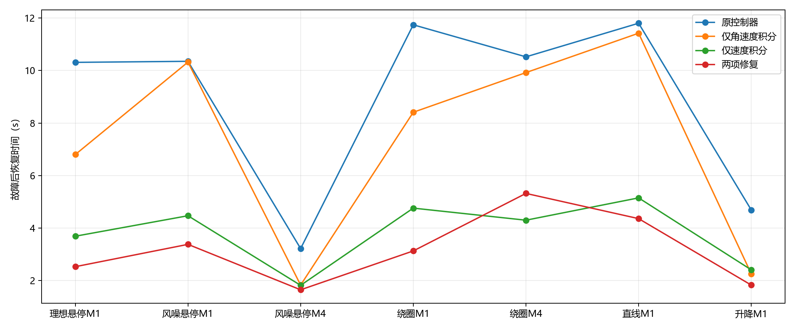
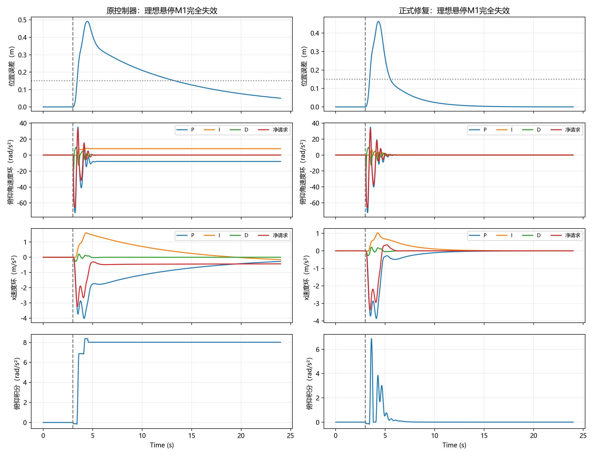
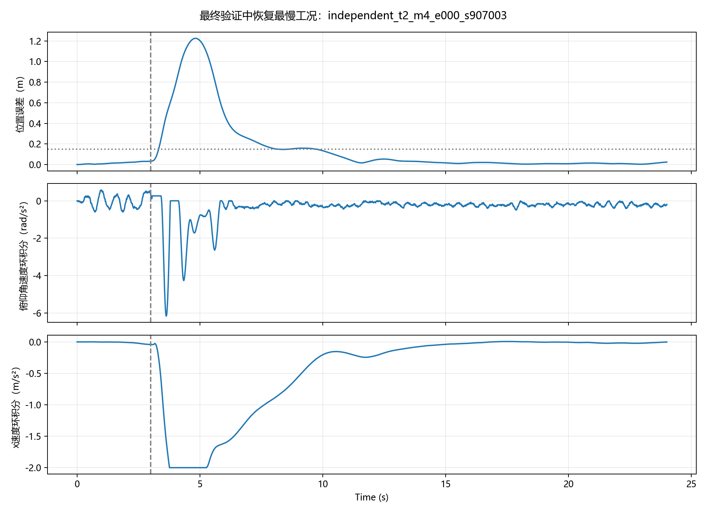

# 六旋翼飞控积分修复与原生模型验证

项目：基于AI可信度框架的动力提升航空器飞控与推进系统失效状态识别适航符合性验证关键技术研究。

日期：2026年11月22日。正式控制器版本：`control_recovery_v4_20261122`。控制冻结提交：`6dd6a9278259e9770506f685743479fd091e0129`。本轮在独立分支实施，未覆盖桌面原项目中的长序列研究修改，未重新训练研究分类器或GAN。

## 1. 已确认的问题与修复

### 1.1 角速度积分受限后不能退出

原角速度环使用反馈四元数计算姿态误差和角速度指令，随后计算角速度误差、PID角加速度请求及力矩：

\[
e_\omega=\omega^*-\omega_{fb},\quad
\alpha^*=K_{p\omega}e_\omega+I_\omega-K_{d\omega}\dot\omega_{fb,LP},\quad
M^*=J\alpha^*+\omega_{fb}\times J\omega_{fb}.
\]

分配器在估计效能限制下得到各电机目标推力；回算和门控使用最终裁剪后的目标推力，而非裁剪前求解器结果：

\[
r=u^*-Af_{final}.
\]

前三轴力矩残差单位为N·m，总推力残差单位为N。这里的“最终分配”是送给执行器的估计目标，实际机械推力还受电机动态、真实效能及气动力影响；两者在导出数据中分别记录。

原门控为 \(r_{M,j}e_{\omega,j}>10^{-8}\)，乘积单位为N·m·rad/s。它抑制受限方向继续积分，但没有区分“继续加重饱和”和“退出已有积分偏置”。无风无噪声悬停M1完全失效，原生复现恢复时间10.31 s；此前完整执行链显示俯仰积分约从4.58 s固定为+8.012 rad/s²，第10 s与约−8.012的比例项抵消。

六旋翼构型中，令臂长为l、反扭矩与推力之比为c：

\[
M_z-\frac{2c}{l}M_y=3c(f_1-f_4).
\]

M1失效且目标 \(f_1=0\) 时，右端非正，俯仰和偏航请求不能任意独立实现。软优先级分配允许很小的俯仰残差；该残差仍可能持续触发原门控。积分于是保留，比例纠偏被抵消。不能把这种状态解释为电机一直没有执行一个很大的俯仰力矩请求。

正式修复保留原门控阈值和残差定义。在估计损伤超过0.1、滚转或俯仰被门控时：

\[
I_{try}=I_k+K_{i\omega}e_\omega\Delta t,
\qquad
I_{k+1}=\operatorname{clip}\{I_{try},\min(I_k,0),\max(I_k,0)\}.
\]

未受限时正常积分；之后仍执行原幅值限制。正积分可减小、负积分可增大并回到零，受限时不能跨零继续积累。约束解除后恢复普通积分。降级偏航保持原有阻尼策略，偏航积分清零。触发来自反馈、估计效能和分配残差，没有读取真实故障时刻或电机编号。未采用定时解锁或定时清零。

这是针对耦合分配的保守修复，保留逐轴限制以减少控制律变更；它没有把逐轴门控宣称为任意构型的最优耦合抗饱和。正负积分、误差反向、跨零、限制解除、幅值限制、健康/降级状态及原故障数值均有回归检查。

11条历史轨迹还与本轮“原控制器”消融记录做了逐时刻比对：最大位置差8.78×10⁻⁷ m、健康绕圈位置差3.58×10⁻¹⁵ m，恢复时间保持原统计值。对照保留旧门控和旧积分增益，但与所有候选共用最终裁剪后的残差修正及等价增量拆分；浮点次序和近零推力会使电机命令最多相差0.726 rad/s，不能宣称逐电机命令逐位一致。完整差异在 `original_reproduction.json`。

代码：`simulink/functions/hex_rate_integral.m` 和 `simulink/blocks/controller_step.m`。

### 1.2 速度积分的慢回位

速度环继续使用任务位置和速度、反馈位置和速度，不添加期望加速度输入：

\[
e_v=\operatorname{clip}\{v_r+K_x(x_r-x_{fb}),-v_{max},v_{max}\}-v_{fb},
\quad a_{raw}=K_ve_v+I_v-K_d\dot v_{fb,LP}.
\]

积分增量拆分为：误差积分、加速度分量限幅回算、竖直力约束回算、倾角回算、总推力回算、总推力分配残差回算、积分自身幅值修正。完整导出这些项，逐行验证其和等于更新后的积分。

原始回算在强约束阶段会形成与比例项相反的积分。例如请求−2.85 m/s²被限制到−1.5 m/s²，回算差值为+1.35 m/s²，并不表示符号错误。约束解除后，原降级水平比例/积分增益4/0.4对应约10 s的慢时间尺度；此前第8 s约−1.065的比例项被约+1.065的积分抵消。

本轮选择改变降级积分的时间尺度，保持原抗饱和形式、2 m/s²积分限制以及持续误差积分，不使用泄漏、周期清零或真值跟踪。令估计效能计算的损伤程度为 \(d\in[0,1]\)：

\[
K_i(d)=(1-d)[0.4,0.4,0.9]^T+d[1.6,1.6,0.9]^T.
\]

水平降级比例增益仍为4，积分时间尺度由约10 s缩短为约2.5 s。对照还测试了降级水平Ki=0.8，即约5 s。选择1.6依据下面的成对开发仿真；物理参数、PID的其余增益、幅值限制、风噪、延迟及故障机制保持原值。

积分状态直接存储加速度贡献，增益变化只改变后续误差积分速度，不在切换瞬间乘大已有积分值。健康参数、原回算项和幅值限制保留，因此恒定误差仍可积累必要的抗扰补偿。

没有加入使用实际运动加速度作为目标的跟踪抗饱和。姿态/电机动态滞后与气动力在离线机械执行链中独立核查，避免混淆含重力的运动加速度与推力加速度。

## 2. 实际参数及选择依据

参数单一来源为 `simulink/configs/research.json`。原配置中的姿态增益8会被 `hex_parameters.m` 覆盖为7、延迟默认值0.01 s又会被正式入口改为0.03 s；本轮将实际使用的7和0.03直接写入配置，消除两处参数身份歧义，不改变正式基线的实际数值。

| 类别 | 实际值 |
|---|---|
| 质量、臂长 | 3.4 kg；0.275 m |
| 惯量J | diag(0.0305275, 0.0305275, 0.059375) kg·m²，几何与质量分布计算 |
| kT、Q/T | 7.45×10⁻⁶；0.01315 m |
| 电机响应、转速上限 | 0.05 s；1100 rad/s；健康初始转速863.813925 rad/s |
| 周期、积分、时长 | 控制/传感器/导出0.01 s；RK4小步0.002 s；24 s |
| 反馈、故障时刻 | 正式及理想检查均30 ms；默认第3 s开始，持续到结束 |
| 健康位置P、速度P/I/D | (4,4,1.4)；(7,7,3)/(0.4,0.4,0.9)/(0.1,0.1,0.1) |
| 降级位置P、速度P/I | (1.5,1.5,1.4)；(4,4,3)/(1.6,1.6,0.9)，按估计损伤混合 |
| 姿态P、角速度P/I/D | (7,7,3)；(20,20,6)/(30,30,0.6)/(0.5,0.5,0.06) |
| 积分幅值 | 速度(2,2,2) m/s²；角速度(20,20,2) rad/s² |
| 风 | 地面系均值0；OU平稳标准差0.2 m/s；相关时间1 s |
| 测量 | 陀螺仪噪声密度0.0003，对应100 Hz下0.003 rad/s白噪声；转速采样噪声1 rad/s；完整传感器参数随每条记录保存 |
| 验收 | 原35°倾角、1 m高度损失、5 rad/s滚转俯仰范数、10 rad/s偏航；末3 s跟踪/路径RMSE各≤0.10 m；恢复≤15 s |

任务0悬停；任务1沿地面x正方向位移1.2 m；任务2半径0.3 m绕一圈；任务3竖直上升1.2 m。起点(0,0,2.5)m，名义运动时段1～7 s，保留原测量反馈参考进度管理器。原任务、PID限幅和进度策略没有重建。

## 3. 成对消融与选型

15个开发条件逐一比较5种方案，共75次24 s原生SLX仿真。覆盖理想/风噪悬停M1/M4、风噪绕圈M1/M4、直线/升降、20%/80%剩余效能、健康、恒定风及持续外力。完全失效不以5%效能近似。

| 方案 | 通过 | 恢复中位数/s | 90%分位/s | 最长/s | 最差末段RMSE/m |
|---|---:|---:|---:|---:|---:|
| 原控制器 | 15/15 | 10.31 | 11.728 | 11.80 | 0.067419 |
| 仅角速度积分 | 15/15 | 6.80 | 10.160 | 11.42 | 0.063366 |
| 仅速度积分Ki=1.6 | 15/15 | 3.69 | 4.644 | 5.15 | 0.012102 |
| 两项，Ki=0.8 | 15/15 | 3.87 | 6.648 | 7.31 | 0.015157 |
| 正式：两项，Ki=1.6 | 15/15 | 2.53 | 3.968 | 5.32 | 0.012102 |

仅速度积分方案仍保留已确认的角速度积分冻结逻辑，因此未因单个最大值略低而选它。正式方案在中位数、较差分位数和末段误差上更好，并修复结构性缺陷。

代表性恢复变化：理想悬停M1/M4 10.31→2.53 s；风噪悬停M1 10.35→3.38 s、M4 3.22→1.65 s；绕圈M1 11.74→3.13 s、M4 10.52→5.32 s；直线M1 11.80→4.36 s；升降M1 4.69→1.83 s。

正式方案这15个条件中恢复时间和末段RMSE均未变差。仍保留全部小幅回退：80%剩余效能绕圈峰值倾角增加约0.0629°；完全失效绕圈M1峰值滚转俯仰角速度增加约0.0154 rad/s。所有方案全部逐条件差异，包括其他候选的回退，见 `validation/control_repair_20261122/all_paired_changes.csv`，不以结果正向作为删除条件。

恒定扰动使用机体系持续外力(0.5,−0.3,0)N，或地面系恒定风(1,0.5,0)m/s（OU标准差置零）。正式方案故障工况恢复分别2.91、3.01 s，末段误差约0.00021、0.00030 m；健康持续外力和恒定风末段误差约0.00171、0.00204 m。保留了积分稳态补偿能力。

## 4. 冻结、构建与入口一致性

冻结前声明独立种子907001、907003、907009；所检索481份历史记录和采集清单中未检出。选型依据及源签名写入 `freeze_receipt.json`，正式冻结提交先于独立验证。若以后据独立结果改控制器，应升级版本并将这些条件列为开发条件。

构建器在隔离目录重建全部7个数值模块，核对实际内嵌脚本哈希并编译，成功后才替换SLX。旧模型按文件哈希备份。模型工作区保存构建身份，避免当前MATLAB版本不支持模型UserData的问题。所有源码和依赖变化会被识别；启动回调也能阻止过期/被改写的内嵌模型运行。

单次、配置、打开模型、`my_simulation`、批量验收和采集均使用相同一致性入口。运行时保存实际Git提交、控制版本、构建源签名和SLX哈希，不依赖文件夹命名推断版本。未保存的模型编辑或另一检出目录的同名模型会被保护，明确报错后可在独立MATLAB会话运行。

回归测试覆盖积分回退、限制方向继续累积、跨零、释放限制、幅值、耦合残差数值、模型过期、未保存编辑保护和A→B→A跨记录状态复位。原生状态/反馈/控制审计完全相同；Fast Restart在独立记录入口关闭。恢复统计同时检查最后采样仍越界、下一点持续入带、记录截断和缺少故障后数据。

## 5. 正式验证与独立复算

实际完成**668次24 s原生SLX仿真**，包括75次消融、40次前置检查、544次冻结后正式记录和9次接口采集；包含有意重复的成对对照，不等于668个独立随机条件。A→B→A状态复位另运行两轮、共6次1 s短仿真，不计入24 s次数。

主矩阵为**532/532通过**：3个开发种子各76项、3个预先声明的独立种子各76项，以及76项理想工况。每组76项为72故障+4健康。另12项运动镜像全部通过飞行验收，冻结后正式记录合计544/544通过。前置40项和接口9项也全部通过各自检查。没有运行失败或被删除的困难类别；初始构建/测试配置失败日志保留，未产生完整飞行记录。

| 条件 | 种子 | 通过/记录 | 恢复中位数/s | 90%分位/s | 最长/s | 最差末段RMSE/m | 任务进度完成 |
|---|---:|---:|---:|---:|---:|---:|---:|
| 风噪开发 | 20261006 | 76/76 | 0.51 | 1.910 | 5.32 | 0.012122 | 76/76 |
| 风噪开发 | 20261007 | 76/76 | 0.52 | 2.080 | 6.31 | 0.013091 | 76/76 |
| 风噪开发 | 20261008 | 76/76 | 0.52 | 1.990 | 6.23 | 0.012991 | 76/76 |
| 理想（30 ms延迟） | 20261006 | 76/76 | 0.52 | 1.960 | 6.06 | 0.000612 | 76/76 |
| 风噪独立 | 907001 | 76/76 | 0.53 | 4.150 | 6.55 | 0.018128 | 76/76 |
| 风噪独立 | 907003 | 76/76 | 0.53 | 2.925 | 6.70 | 0.013091 | 76/76 |
| 风噪独立 | 907009 | 76/76 | 0.52 | 2.080 | 6.55 | 0.010505 | 76/76 |

主矩阵最长恢复6.70 s，最差末3 s跟踪RMSE为0.018128 m，最大倾角24.398°，最大滚转俯仰角速度范数3.466 rad/s。有限性、转速及两类积分幅值全部通过。受控参考恢复、末段几何路径误差、名义时序误差、任务进度分别保存，主矩阵任务进度完成532/532项。没有以慢推进替代完整任务检查。

同20261006历史72项核心矩阵配对：最长恢复由11.80降至5.32 s，最差末段RMSE由0.063646降至0.011886 m。共有66项在恢复/末段误差/倾角/角速度至少一个指标上出现增加，均完整列入 `core_72_any_metric_regressions.csv`；通过验收不等于每个指标都改善。具体为：仅绕圈M5剩余80%效能的恢复时间增加0.02 s（1.31→1.33 s）；末段RMSE没有增加；峰值倾角最大增加0.226°，滚转俯仰角速度范数最大增加0.0437 rad/s，均在原门槛内。

对**584份CSV**（正式544+前置40）使用独立Python实现重新核对2401个时间戳、有限性、恢复时间、末段RMSE、最终分配残差、速度积分增量之和、滚转/俯仰积分增量和受限向零退出规则，并重算文件哈希，全部通过。汇总和逐条复算在 `native_cases.csv/json` 与 `independent_csv_recomputation.csv`。恢复时间保留最后一次越界减故障时刻，同时记录下一采样点持续入带时刻；最后一点仍越界、缺失故障后数据或记录不完整明确标为未恢复/不可评价。

## 6. 镜像、步长和故障时刻

镜像按几何构造 \(S=I-2nn^T\)，极向量用S，角速度、力矩、旋转误差等轴矢量用det(S)S，电机及转速噪声通道按旋翼位置诱导的置换处理。静止初始姿态对应 \(R'=SRS\)；运动工况同时改变路径方向。相同种子本身不视为镜像。

悬停M1/M4镜像检查位置最大差：理想约1.93×10⁻⁹ m、风噪约1.98×10⁻⁷ m，恢复时间一致。M2/M5、M3/M6未达到严格几何镜像一致：悬停位置最大差0.035～0.090 m，角速度最大差约1.28～1.32 rad/s，恢复时间差0.08～0.14 s。输入风与外生误差变换残差为浮点精度量级，不能把输出差异归因于“扰动没镜像”。

现有控制器逐轴分量限幅和逐轴积分门控不对任意平面旋转/反射保持等变；分配器的滚转、俯仰归一化尺度也分别为8.587465、9.915950 N·m，权重分别约0.349346、0.302543，轴混合镜像下不交换等价。因此，几何对称不代表该实现对所有反射严格对称。本轮没有为获得对称图而另改分配权重或限幅；这是明确保留的实现范围限制。各镜像工况是否通过飞行验收与严格对称性分别报告，不能混为同一结论。

例如，M2/M5的轴矢量变换在水平面为 \(H=[-0.5,0.866;0.866,0.5]\)。对(4,0)按各轴±3限幅，先限幅再变换得到(−1.5,2.598)，先变换再限幅得到(−2,3)，两者不同。这直接证明逐轴限幅不等变；没有逐项消融确定它与分配权重分别解释了多少轨迹差异。

6个代表条件以0.002/0.001 s积分小步成对运行，控制/传感器/导出周期与外生输入保持一致。最大位置轨迹差1.11×10⁻⁶ m，恢复时间差0，均满足预先设定的位置差0.02 m、恢复差0.1 s检查阈值。

额外故障时刻为1.5和5.5 s，覆盖4任务、M1/M4，共16次；保持24 s总时长，全部通过。正式控制器不使用这些时刻触发积分清零/解锁。

## 7. 后续数据接口

旧CSV字段保持兼容，附加112个有名称、单位和坐标系的诊断字段，正式CSV共257列。每条完整记录2401个时刻。MAT保存完整参数与预生成外生输入；JSON保存Git/构建/参数/哈希/完成状态；逐时刻字段可复算积分更新、分配残差和恢复指标。

12维分类输入为加速度计3、陀螺仪3、带噪延迟转速反馈6。IMU仅施加一次因果对齐；RPM直接用 `feedback_state_14..19`，无真值替代，无重复延迟。修改命令、真实转速、效能和诊断列不改变12维特征；缺测量列时拒绝读取。

实际采集9条新版绕圈记录，训练、验证、测试各一个独立种子，每组健康、M1完全失效、M1剩余80%效能各一条。各2401×12，现有加载/标准化/前向流程通过；标准化只拟合3条训练记录的7203个时刻。故障前逐时刻标签健康，之后为对应故障类；记录级与前缀标签分别保存。整条与137点计算分块前向最大差5.96×10⁻⁸。

另只读加载原桌面项目中尚未提交的LSTM/CNN实现，在相同9条新版记录上检查前向、缓存传递和因果性。LSTM分块最大差2.98×10⁻⁸，CNN为5.96×10⁻⁸，改变未来输入不影响过去输出（差值0）。这属于随机初始化权重的接口验证，不代表分类准确率，也没有覆盖用户原文件。

新版正式数据版本为 `simulink_control_v4_observable_20261122_v1`，独立清单预留12个条件组、228次记录：训练6组114条、验证3组57条、测试3组57条，种子810101～810112。这份大规模清单已形成，尚未采集或训练，不能把计划次数计入实际仿真完成数。9条接口记录使用单独的820101/820103/820107及独立接口版本，不能算作完整19类数据集。

历史数据继续保留原 `control_v3_20261023` 身份，新加载器仅在清单显式声明新版时接受新版本。以后完整采集按独立条件组固定用途，scaler只拟合训练来源。不得把同组的故障前前缀当作独立健康实验重复统计。

## 8. 证据位置、使用范围和后续

原始证据根目录：`C:/Users/lenovo/Desktop/eVTOL_Simulation/output_control_repair_20261122`。

- `development_01`：75次消融、计划、原生MAT和日志。
- `preflight_01`：40次镜像/步长/故障时刻，完整CSV/MAT及逐条收据。
- `formal_01`：冻结后的主矩阵及运动镜像，完整257列CSV/MAT、元数据、计划、日志。
- `interface_01`：9条实际新版采集记录、标准化与前向收据、2401×12数组及三种标签。
- `dataset_v4_frozen`：后续228条记录的采集清单，未执行。

仓库汇总位于 `docs/validation/control_repair_20261122`：逐条件/种子CSV、完整JSON、独立CSV复算、候选回退、镜像/步长审计、冻结收据、数据版本/来源清单和图。原始大文件不纳入Git，文件哈希可核查本地证据；日志中的构建失败和首次网络推送失败均保留，不计为飞行验收失败。

本模型是当前设计参数、4类任务、单电机3档效能、所声明风噪/延迟和随机条件下的仿真基线。参数仍属研究设计，未由这次工作证明真实飞机适航符合性；没有验证多电机故障、任意大风、硬件延迟抖动、电池电压变化或跨机型。严格轴混合镜像等变性仍不满足。后续研究应使用冻结后的新采集版本，再进行分类器/GAN正式训练和独立来源评价。

运行步骤见 [正式模型运行与数据接口](CONTROL_REPAIR_USAGE.md)。
