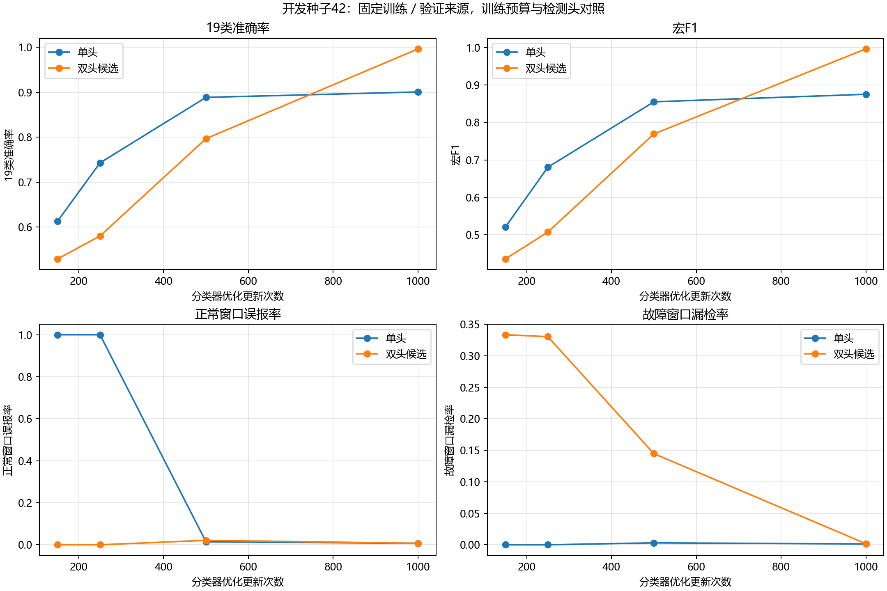
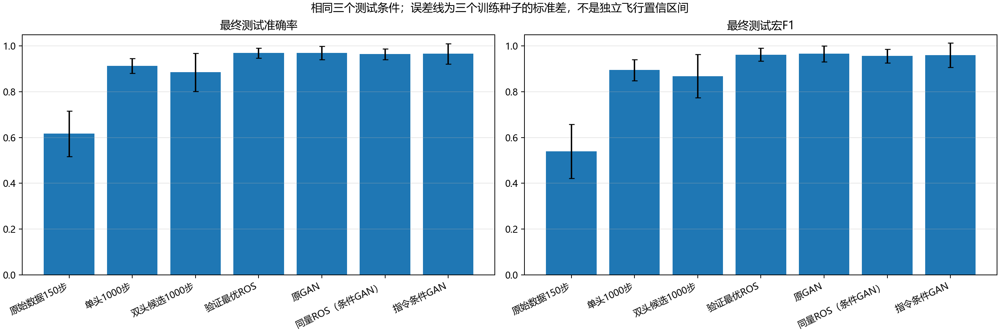
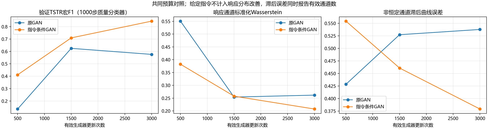

# Simulink GAN V2：实际实验结果

日期：2026-11-04。基线 `6f94612`；功能分支 `codex/simulink-gan-v2`。

配置冻结签名：`ff6c26fbc613e6884af05434614a55f2f0b8e3e947fe4efe618a51ce0c7d9f76`。冻结前测试特征读取数为 0；全部冻结模型完成后才统一评价。

228 条仿真记录来自 12 个配对条件组；训练／验证／测试为 6／3／3。旧四组 76 条记录原位引用，新增八组 152 条记录；任务、模型、故障强度和控制参数保持不变。
最终三个训练种子 42、43、44 共享相同三个测试条件，因此不能把九个种子×条件组合当成九次独立飞行。窗口均值是描述性分类指标；统计独立的测试条件只有三个。

## 本轮结论

增加训练预算是本轮最明确的收益：原始数据分类器准确率由 61.64% 提高到 91.30%。原 GAN 与同量 ROS 的准确率均值只差 +0.06 个百分点，配对差异有正有负，目前没有充分证据认定 GAN 增广优于简单过采样。
指令条件 GAN 在验证生成质量上更好，但最终报警稳定性更差。不能用较高的分类准确率或 TSTR 代替正常误报和新故障检出表现；本轮不建议据此替换现有诊断配置。
IMU＋指令消融准确率为 99.47%，仅 IMU 为 23.33%，已知电机响应规则达到 100.00%。这些结果提示当前分类能力主要依赖闭环指令及其响应关系；不能作为仅凭 IMU 就能识别真实桨叶损伤的证据。消融仅用于本轮评价，没有据测试结果重选主特征。

## 固定选择与阶段结果

分类器统一 1000 次优化更新，保留同一训练轨迹的第 150 步作为短预算对照；所有长预算控制共用相同初始种子、学习率、批量设置和更新次数。训练、验证、测试各 4818／2409／2409 个窗口，包含正常全时段与故障过渡段，重复健康前缀不作为十八份来源。
检测头提高了开发种子的 19 类验证分数，但正常误报和二分类平衡错误率没有达到预设采用门槛。因此主要增广比较保留单头，双头候选完整保留为独立对照，不根据最终测试重新改变这个决定。
该采用门槛也有局限：预设要求平衡错误率绝对下降 0.005，而开发单头的错误率已为 0.00421，低于门槛本身；双头约为 0.00443。本轮门槛过于保守，不能由未被采用推断双头无价值。需要在新实验的验证集上重新预设相对改进或事件指标，不能据本轮测试追改规则。
两种 GAN 在开发阶段均保存 500、1500、3000 次有效生成器更新；质量分类器使用 1000 次更新。验证选择共同预算 3000，原 GAN 比例 0.25、指令条件 GAN 比例 0.5、最优 ROS 比例 0.25。另保留两种 GAN 各自同量的 ROS，消除新增数量差异。
比例、头设计和报警阈值／持续次数由验证组选择，三个最终训练种子共用同一套冻结选择；没有根据测试重新调参。

## 最终测试

|对照|准确率均值 ± 训练种子标准差|宏F1|正常窗口误报率|
|---|---:|---:|---:|
|原始数据150步|61.64% ± 9.93%|0.5391|1.65%|
|单头1000步|91.30% ± 3.22%|0.8948|1.65%|
|双头候选1000步|88.52% ± 8.38%|0.8685|5.20%|
|验证最优ROS|96.94% ± 2.20%|0.9621|0.95%|
|原GAN|97.00% ± 2.96%|0.9664|0.24%|
|同量ROS（原GAN）|96.94% ± 2.20%|0.9621|0.95%|
|指令条件GAN|96.60% ± 4.49%|0.9599|4.73%|
|同量ROS（条件GAN）|96.44% ± 2.40%|0.9562|0.71%|
|IMU＋指令|99.47% ± 0.42%|0.9950|0.00%|
|IMU＋转速|50.98% ± 2.50%|0.4128|0.00%|
|仅IMU|23.33% ± 0.61%|0.1202|16.31%|
|电机响应残差规则|100.00%|1.0000|0.00%|

误差范围是三个训练随机种子的波动，不是实飞有效性或统计显著性的证明。规则基线有已知电机动力学／延迟与当前故障模型匹配的优势，不能直接外推到桨叶气动损伤或未知传感器链。

最终窗口分类先按各自验证冻结的阈值判定正常／故障，再从十八个故障类别中定位；因此表中为该工作点下的 19 类结果。开发训练曲线统一使用 0.5 阈值，两者口径不同。

## 检测与定位

|对照|冻结阈值／持续次数|平均误报事件数／每种子正常观测秒数|平均漏检／54|检出条件中位延迟的均值／s|首次定位正确率|
|---|---:|---:|---:|---:|---:|
|原始数据150步|0.9／2|3.00／69.00|11.00／54|0.440|62.94%|
|单头1000步|0.9／2|1.00／69.00|0.33／54|0.390|89.35%|
|双头候选1000步|0.1／2|5.00／69.00|0.00／54|0.323|83.33%|
|验证最优ROS|0.1／2|1.00／69.00|0.00／54|0.323|82.10%|
|原GAN|0.9／2|0.33／69.00|0.00／54|0.373|96.91%|
|同量ROS（条件GAN）|0.6／2|1.00／69.00|0.00／54|0.357|93.21%|
|指令条件GAN|0.1／2|4.33／69.00|15.00／54|0.373|92.59%|
|电机响应残差规则|0.1／2|0／69.00|0／54|0.190|100.00%|

检测延迟仅在检出样本中定义，漏检同时列出。首次定位准确率按已经产生定位的样本计算；原始 JSON 另有对全部故障的首次正确定位覆盖率、首次正确定位延迟及最终正确定位率。不能用“后来终于定位正确”代替首次定位准确率。
每个训练种子的正常观测为相同三个健康来源，分别只统计一次；每条 24 秒记录在首个 100 点窗口形成后提供约 23 秒可评价时长，共 69 秒。故障记录中重复的健康前缀不增加观测分母。有限时长内零误报不代表长期误报率为零。

指令条件 GAN 的训练种子 43 在 69 秒正常观测中产生 12 次误报；54/54 条故障记录在故障发生前报警已经激活，按预设“新上升沿”规则漏检 45/54。持续误报警不能算成成功检测新故障，条件检测延迟也不能掩盖这些漏检。冻结阈值在三个训练种子间迁移不稳定，后续需用新验证试验研究校准或报警状态机。

## 逐组配对差异

- `command minus plain`：逐种子×逐测试组准确率差均值 -0.40 个百分点，范围 [-3.99, +1.37]；宏F1差均值 -0.0064。
- `command minus ros_matched_command`：逐种子×逐测试组准确率差均值 +0.15 个百分点，范围 [-10.34, +5.48]；宏F1差均值 +0.0037。
- `dual_candidate minus raw_single`：逐种子×逐测试组准确率差均值 -2.78 个百分点，范围 [-10.46, +10.83]；宏F1差均值 -0.0267。
- `plain minus ros_matched_plain`：逐种子×逐测试组准确率差均值 +0.06 个百分点，范围 [-2.49, +3.74]；宏F1差均值 +0.0042。
- `raw_single minus raw_short`：逐种子×逐测试组准确率差均值 +29.65 个百分点，范围 [+19.18, +36.49]；宏F1差均值 +0.3557。

详细九个相关单元的差值保存在 `paired_group_differences.csv`，用于查看同一来源和同一训练种子的差异，不据此计算伪独立显著性。

## 生成质量与限制

验证质量同时记录逐类逐通道分布、频谱、带常值标记的滞后曲线，以及训练最近邻和重复情况。响应通道的 Wasserstein 与给定指令列分开报告；条件生成复制指令是定义的一部分，不能算成学会了控制输入生成。
TSTR 与滞后结果反映当前仿真分布上的改善，不等于完整动力学约束；物理正则保持关闭。所有 GAN 样本仍只来自六个训练条件，不能增加独立飞行来源。

数据完整且数值有限、但未通过飞行恢复验收的记录共 1 条，仍全部保留，清单见来源 registry。没有降低故障强度、放宽恢复阈值或删除困难类别。

## 验证、产物与续跑

47 项测试通过。实际产物审计核对了原始来源／角色、旧文件哈希、模型参数一致性、训练组内 scaler、真实优化器计数、GAN／ROS 数量、指令条件来源和冻结测试授权。
主代码、配置和运行步骤见 [V2 使用说明](SIMULINK_GAN_V2.md)。完整原始记录、权重、逐时刻预测及日志在 `output_simulink_gan/v2_12groups/`；紧凑证据在 `docs/validation/simulink_gan_v2_20261104/`；统计 CSV 和图在结果目录的 `report/`。
可在同一代码与配置下重新运行 `final_train` 恢复已保存优化器状态，并用 `test` 复用同一冻结测试收据。修改代码、数据或选择需要新的实验目录和新的研究协议，不能在本测试上反复选配置。

## 完成状态与后续边界

代码已实现、规定训练预算已执行、固定划分流程已跑通；是否有稳定增益要结合上述同量配对结果和三种子波动判断，不能只看一个均值。训练收敛、跨任务／参数失配、真实桨叶损伤和实飞泛化均未验证。UAV-FD 最终测试集未解锁。
下一步应在新来源上预先设定跨任务或参数失配试验，并用独立验证数据决定是否需要置信校准；不能根据本轮测试再修改头设计、比例或报警规则。
