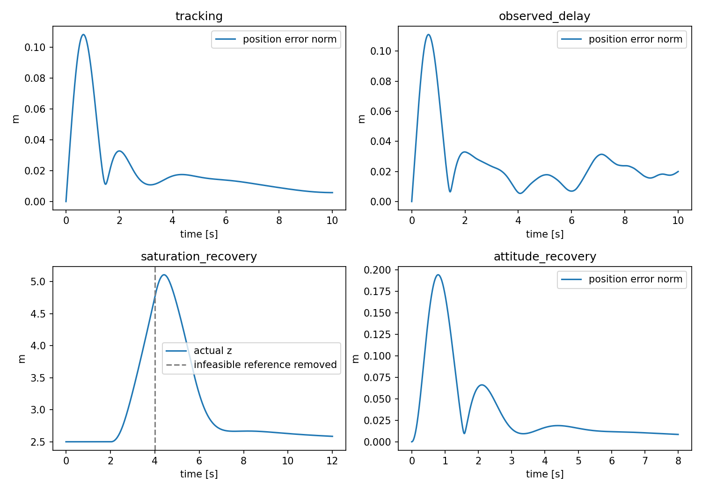
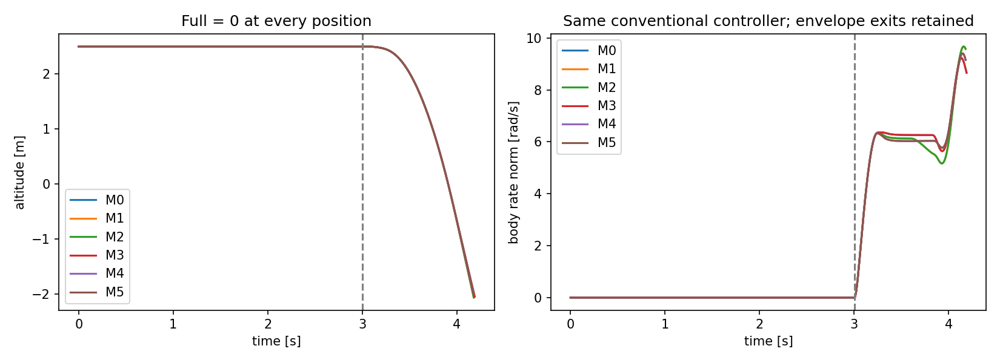

# 实际验证报告

所有数字来自运行结果。完整指标见validation_metrics.json；阈值是运行前声明的研究要求，不是适航标准或实飞事实。

## 基线与模块检查

原工作区24测试通过，输出baseline_tests.txt；原分配器10项保留，新增边界/时序/传感器/输出检查，最新输出见checks.txt。原候选惯量虽基线测试通过仍不满足真实惯量三角约束，说明代码测试与物理证据状态必须分开。

## 正常闭环

| 工况 | 位置RMSE m | 最终误差 m | 最大倾角 deg | 反馈 | 判定 |
| --- | ---: | ---: | ---: | --- | --- |
| attitude_recovery | 0.0603018 | 0.00853495 | 10.32 | ideal_feedback | True |
| constant_disturbance | 0.055655 | 0.0306106 | 3.147 | ideal_feedback | True |
| hover | 2.30507e-14 | 9.69443e-15 | 0 | ideal_feedback | True |
| observed_delay | 0.0343457 | 0.0199581 | 4.413 | observed_feedback | True |
| observed_noise | 0.036363 | 0.0175244 | 4.186 | observed_feedback | True |
| rate_recovery | 0.0189592 | 0.00266226 | 2.65 | ideal_feedback | True |
| saturation_recovery | 20.0661 | 0.0848661 | 0 | ideal_feedback | True |
| step | 0.192019 | 0.00158783 | 8.5 | ideal_feedback | True |
| tracking | 0.0315703 | 0.00577726 | 3.815 | ideal_feedback | True |

saturation_recovery在2–4秒请求不可行的50m高度，同时转速上限降低为950rad/s；其大RMSE反映不可行参考，不用它宣称跟踪通过。判定只使用参考解除后的最终恢复误差，并记录实际饱和比例与积分状态。常量扰动为预定1/-0.5N机体水平力，2–6秒施加。

### 步长和敏感性

control减半：最大位置差0.00074680862m，研究阈值0.03m，判定True。

integration减半：最大位置差3.355318e-11m，研究阈值0.02m，判定True。

敏感性共10组，质量/惯量与几何/惯量相关联重算；均为设计范围，不是统计CI。每次独立仿真指标和耗时在机器报告中，窗口没有被当作独立重复。

同一M0 Partial的11次设计敏感性运行（基线+10变体）使用相同50点窗口；y陀螺RMS范围0.538115–0.670682rad/s。配置变化时名义控制模型也跟随，因此不能解释为参数失配鲁棒性。完整三轴比力/陀螺统计见fault_feature_sensitivity.json。

## 故障动力学与能力边界

| 类别 | 实際终止 | 时长 s | 故障初期稳态/动态推力最大差 N |
| --- | --- | ---: | ---: |
| motor0_full | physical_envelope_exit | 4.19 | 7.43464 |
| motor0_partial | completed | 7 | 0.998269 |
| motor0_severe | physical_envelope_exit | 4.22 | 3.87279 |
| motor1_full | physical_envelope_exit | 4.18 | 7.60075 |
| motor1_partial | completed | 7 | 0.998269 |
| motor1_severe | physical_envelope_exit | 4.22 | 3.87279 |
| motor2_full | physical_envelope_exit | 4.18 | 7.60075 |
| motor2_partial | completed | 7 | 0.998269 |
| motor2_severe | physical_envelope_exit | 4.22 | 3.87279 |
| motor3_full | physical_envelope_exit | 4.19 | 7.43464 |
| motor3_partial | completed | 7 | 0.998269 |
| motor3_severe | physical_envelope_exit | 4.22 | 3.87279 |
| motor4_full | physical_envelope_exit | 4.18 | 7.564 |
| motor4_partial | completed | 7 | 0.998269 |
| motor4_severe | physical_envelope_exit | 4.22 | 3.87279 |
| motor5_full | physical_envelope_exit | 4.18 | 7.564 |
| motor5_partial | completed | 7 | 0.998269 |
| motor5_severe | physical_envelope_exit | 4.22 | 3.87279 |
| normal | completed | 7 | 7.10543e-15 |

6个Full状态LP均零力矩悬停可行：True。秩为4，但所有幸存执行器同时离开边界的最大比例为[-0.0, -0.0, -0.0, -0.0, -0.0, -0.0]；不能据满秩断言有充分四通道控制裕度。

120度旋转下分配列对称误差1.7931522e-16。八条控制轴方向LP裕度在capability.json，未冒称最大可达内球。

常规控制器无故障真值，也未按故障位置换增益；Full/Severe早停是该工况实际响应，未把0改成0.05。lambda是执行器目标效能现象，未模拟轴承/绕组/转子具体机理。

## 数据与学习接口

数据集24条早停的实际触发条件均为z<-2m，详情termination_audit.json。它是本仿真采样包络规则，不是飞机必然无法控制或真实碰地时刻。未实现地面接触；静态可行性与当前有限时间控制结果分开记录。

实际生成38条独立类来源，2个配对run组；完整性检查通过，24条明确早停。所有类按同一3.05–3.65s窗口；38文件不是38独立环境组，公平分组单位为2个run组。

学习接口实际检查结果：`learning_smoke.json`，命令输出见learning_checks.txt。1epoch/2fold只判断接口和折内流向，不当成识别性能证据。

rotation_combined的21维输入也实际完成两折一轮接口，输出learning_checks_rotation_combined.txt。原18维combined仍保留；接近88.7度的欧拉俯仰不具正式学习有效性支持。默认机体角速度与IMU陀螺三列存在冗余。

纯WGAN一轮生成的诊断旋转列不满足正交：两折平均列正交误差约1.26/1.23，详见rotation_generator_check.json。没有启用姿态流形投影或相应物理正则，因此不能把这些生成列当成物理姿态已验证。均衡数据下max增广数量为0，WGAN分支分类数字的差异不能证明增广改善。

## 仍未验证的边界

本研究的真实质量、COM、惯量、推力/扭矩、电机延迟、气动与传感器频谱没有实机匹配。直接姿态/位置/速度误差模型不是完整EKF。完整PX41.12.3定制固件、ArduPilot复刻、大范围翻滚/着陆接触、旋翼陀螺/弹性振动和长时完全失效控制未成立。正式训练和实飞迁移未进行。

初次Normal CSV导出触发可选fault_time字段不属于数字列的KeyError；已修复为仅对该可选列忽略缺省，加入真实Normal导出回归，并保留失败计划快照。没有异常回退到随机数据。
