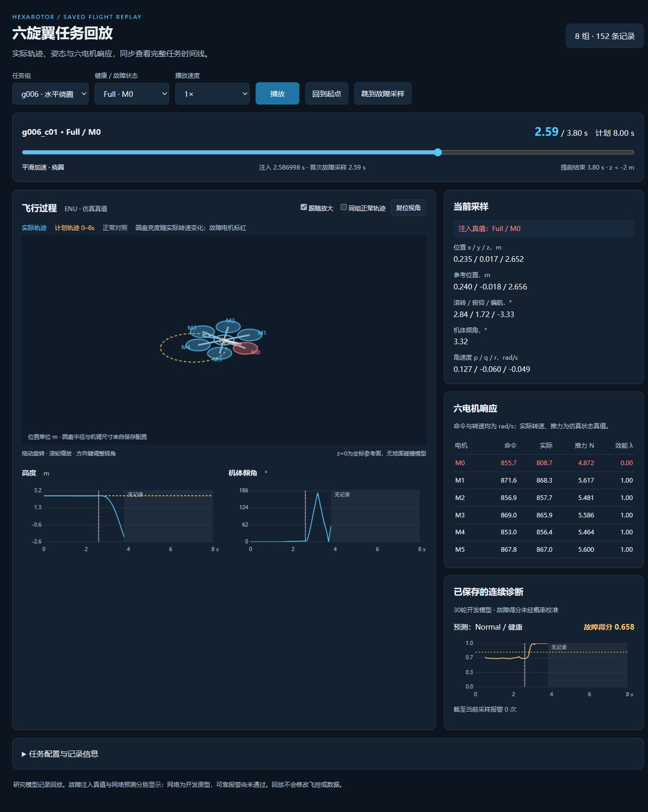
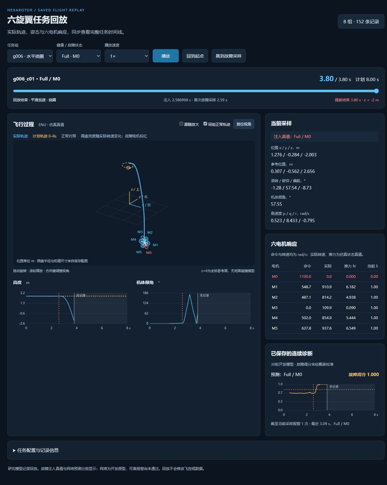
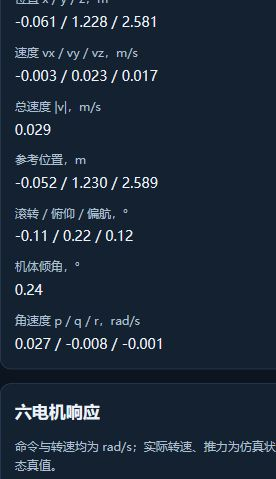

# 动画回放实际验证

执行日期：2026-10-10。工作分支：`hex-tasks-continuous-diagnostics`，本轮修改前基线 `15afdd4041ec0b754a9eb801132e0354dac5d0e5`。
所有新显示代码在独立 `hex_viewer` 包中，入口 `view_hex_tasks.py`；原始动力学、控制、造数、故障定义与诊断程序均未修改。

## 数据与来源检查

实际执行 `python view_hex_tasks.py --check` 与 `python -m hex_viewer.audit --output docs/hex_next/animation_data_checks.json`。
原始CSV/JSON和已保存预测均只读，审计输出单独写入docs。

| 检查 | 实际结果 |
| --- | --- |
| 任务与记录 | 8组、152条、84,710个保存采样 |
| 完整到8秒 | 56条：8条Normal和48条Partial |
| 提前结束 | 96条Full/Severe，实际末尾3.78–4.64秒，全部末尾高度低于−2米 |
| 显示数据逐值核对 | 时间、位置、速度、姿态、角速度、参考、命令、实际转速、推力、效能与CSV完全一致 |
| 完整计划与保存控制参考 | 每一实际采样的计划位置一致，最大差0米；早停后只保留计划虚线 |
| 数据保存 | 383个数据/预测文件审计前后SHA256相同，0个源文件变更 |
| 补齐实际轨迹 | 0个补齐采样 |
| 已保存诊断 | 76条，位于g002/g004/g006/g008；其余组明确显示没有保存预测 |
| 生成时源码直接匹配当前源码 | 四个既有UTF-8修复文件不匹配，完整差异如实保留 |
| 四个既有源码差异的追溯 | 生成时快照全部匹配生成计划，当前文件全部匹配原登记修复；原始记录未重新签名 |

机器报告：[animation_data_checks.json](animation_data_checks.json)。
已有源码登记：[source_snapshot_generation/register.json](source_snapshot_generation/register.json)。
本轮 `git diff HEAD -- diagnostics/preprocessing.py diagnostics/workflow.py hex_research/continuous_data.py hex_research/next_steps.py` 为空。

## 自动检查

`python -m unittest discover -s tests -v`：**43/43通过**，包含原37项及新增6项。
新增检查覆盖真实末尾不填充、篡改CSV拒绝且不重写、时间与非有限值拒绝、身份/时长一致、预测缺失或损坏不替换为真值，以及HTTP只开放约定资源。

`node tests/check_hex_replay.mjs`：通过。检查播放时钟夹紧、只选择不晚于当前时刻的预测、ENU/FLU姿态正向旋转和任务阶段边界。
Python编译及前端模块语法检查通过。运行播放仅需Python标准库和支持Canvas的现代浏览器。

## 浏览器实际操作

使用Codex内置浏览器，桌面断点1280×1000与默认窄窗口均检查。
保存了**31项操作检查**，浏览器错误/警告日志为空。
详细状态、显示数值和电机映射：[animation_ui_checks.json](animation_ui_checks.json)。

- 八组Normal分别切换并定位到8秒，均正常显示末尾状态。
- g006的全部19种状态逐条加载，末尾和M0…M5效能对应正确；Full为0、Severe为0.2、Partial为0.8。
- g006_c01从故障采样以4倍速播放，实际在3.80秒停止；时间轴最大值3.8，末尾高度−2.003米。
- 故障采样跳转到2.59秒，显示精确注入时间2.586998秒。M0此时效能0、实际转速808.7rad/s、推力4.872N，保留动力学衰减过程。
- 同一故障采样，注入真值Full/M0而网络仍预测Normal，二者独立显示；未提前显示未来窗口。
- g001没有预测时显示“没有保存预测”；回到起点后显示尚未注入故障，不因最终记录标签提前标红。
- 同组Normal叠加、跟随放大、方向键视角和复位视角实际操作通过。
- 默认窄窗口无水平溢出，点击高度曲线可定位采样并暂停；播放/暂停和重置操作通过。

### 故障采样：保留电机动态，预测与注入真值分别显示

### 实际提前结束：正常对照留在参考高度，故障轨迹降到包络下限

## 原有未通过项

回放没有改变Full/Severe的96条提前结束结果，也没有改变开发网络的可靠报警失败结果。
已有30轮开发模型仍有5次健康误报、13/72故障漏检，见[前两批验证报告](VALIDATION_REPORT.md)。
研究参数并非实机确认值；z=0为参考坐标面，没有地面碰撞模型，不能把回放图当作实飞或碰撞验证。
本轮未合并或推送。

## 速度显示补充检查（2026-10-10）

在“当前采样”的位置字段下增加世界ENU三轴速度和总速度，单位m/s。
三轴速度直接读取同一保存采样的 `truth_vx/truth_vy/truth_vz`，总速度按其模长计算，显示到小数点后三位。
切换记录时清空旧速度；播放、定位时间和重置均沿用同一采样索引更新。
前端模块语法检查通过；浏览器实测与CSV核对：g006健康记录0秒为三轴0、总速度0；
g004健康记录8秒为 `−0.003 / 0.023 / 0.017 m/s`、总速度 `0.029 m/s`。浏览器错误/警告日志为空。

