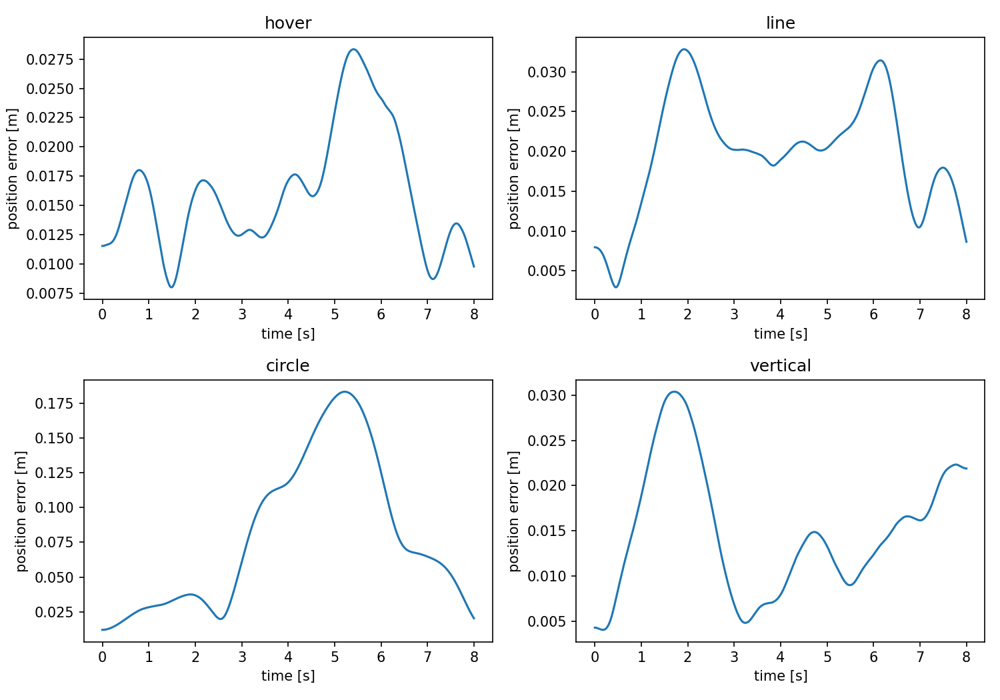
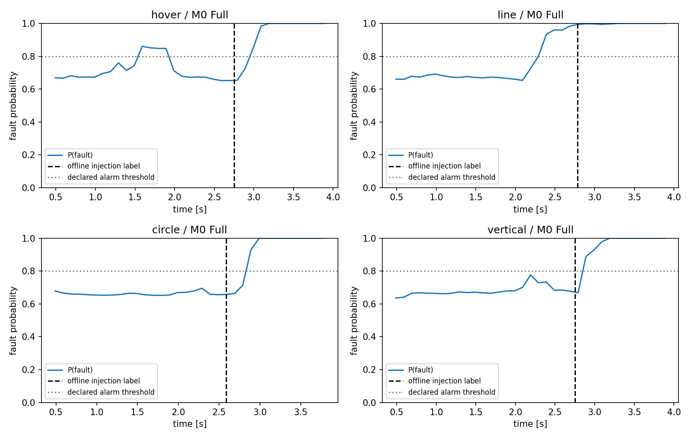

# 第1、2批实际验证报告

需求文件日期2026-10-09，执行续接日期2026-10-10。基线63b9d7e，独立分支`hex-tasks-continuous-diagnostics`。
所有数值来自实际运行。任务库与因果诊断接口已实现；**可靠连续报警验收尚未通过**。

## 第1批：基线、任务接口与观测白名单

复现旧27项测试、9个正常工况和19类故障，结果保存在`baseline_validation.json`。
新增`commands.py`四类参数化任务，保留旧hover/tracking/step/saturation入口。
任务只在控制时钟采样，控制和导出共用缓存；诊断回调只在传感器时钟调用。
新增6/12/18维观测白名单，不读任务参考、真实故障效能、时刻、标签、编号或未来样本。
原LSTM/attention/head结构抽为可部署模块，旧分类入口保留其参数和权重键；WGAN主体未改。
第1批34项检查通过，本地提交ab62312；最终增加观测CSV、缺样和泄漏检查后共**37项通过**。

## 第2批：新正常机动

四类任务各2个参数配置，共8组，每组验证理想反馈、风、含噪风反馈和30ms延迟反馈：**32/32通过**。
阈值在运行前保存，不修改原控制增益；RMSE要求0.25m、最终误差0.10m、倾角35°、角速度3rad/s、名义饱和比例0.05。
最大位置RMSE **0.109538m**，最大实际倾角 **12.5082°**。
绕圈实际覆盖顺/逆方向，升降覆盖上升/下降。验证仅覆盖抽出的8个配置，参数范围不是全范围稳定性证明。

## 第2批：19类配对完整时序

| 项目 | 实际结果 |
|---|---:|
| 配对group | 8 |
| 完整来源 | 152 = 8×19 |
| Normal和Partial完成8s | 56 |
| Full/Severe包络早停 | 96 |
| 故障前观测前缀不一致 | 0 |
| 不足完整故障窗口的来源 | 0 |
| 最短故障后可用时间 | 1.14924s |
| 最少故障后采样 | 115 |
| 最少纯注入故障窗口 | 6 |

96条早停的实际触发条件均为z<-2m，详情`termination_audit.json`。该包络不等于实际碰地或真实坠毁。
所有六个位置Full均为0、Severe为0.2、Partial为0.8；名义飞控不读取故障真值。
故障后继续执行同一外部任务，保留过渡和早停前数据，不复制末值或按类别筛选稳定片段。
152条来源的源码哈希都与执行时生成计划一致，见`generation_source_check.json`。

## 因果窗口、去重及部署入口

三种特征的完整数组分别为 **(7815,50,6)、(7815,50,12)、(7815,50,18)**。
其中720个跨注入边界窗口保留用于连续评估；3582个完全相同的健康训练窗口明确去重。
纯窗口、去重后的训练候选共3513个。窗口不是独立飞行重复。
时间位置不依赖故障时刻；不全记录拟合缩放、不未来插值。50点/10点步进从足够历史开始。
缺样、无效采样和早停尾部检查通过；保留旧18/21维方案的历史身份，不静默混合。

实际完成：

- 根目录`data_process.py`与共享预处理函数输出的npy逐字节一致。
- 两个模型各76条开发回放记录，逐点回放与离线因果窗口的概率差均为0。
- 30轮模型实际接入仿真观测回调：Normal76次预测、Full35次预测，与CSV回放概率差均为0；飞行终态一致。
- 删除CSV全部标签、参考、任务与日程，仅留下时间/有效标志/6列IMU，独立`diagnose_hex.py`产生35次相同预测。

这些检查验证输入和因果流程，不替代报警有效性。

## 实际连续报警结果：未通过项完整保留

使用同一LSTM结构、同一初始化和同一原始训练窗口；训练group为1/3/5/7，开发回放为2/4/6/8。
缩放只在训练窗口拟合。阈值保持0.8、持续3窗、冷却1s；两个实验全部是开发数据。

| 指标 | 初始3轮 | 后续30轮开发拟合 |
|---|---:|---:|
| 纯开发窗口Macro-F1 | 0.31785 | 0.77309 |
| 纯开发窗口准确率 | 0.13477 | 0.69126 |
| 健康Normal实际时长 | 32s | 32s |
| 健康误报事件 | 4 | **5** |
| 故障事件 | 72 | 72 |
| 停止前有效新报警 | 0 | **59** |
| 可评估故障漏检 | 72 | **13** |
| 已检出事件延迟中位数 | 无 | 0.54026s |
| 已检出事件延迟范围 | 无 | 0.34026–4.10831s |

30轮是在三轮失败后预先记录的开发追查，检查更多拟合是否改善；原训练窗口ID、模型结构、scaler、报警参数和回放group相同。
前三轮损失序列相同，另存新目录，不覆盖初始失败模型或预测。这不构成GAN扩增效果比较。

30轮的13个漏检均位于直线group4：6个Full、6个Severe及M1 Partial。
该组故障前就报警；Full/Severe的高得分持续至早停，不能把先前误报算作故障成功检出。
在59个已检出事件中，首次报警正确定位39个、正确严重度50个、联合19类正确35个；总体联合成功为35/72。
逐记录与逐类结果见`continuous_replay_epoch30.json`、`class_recall_epoch30.json`。

图中虚线故障时刻只用于事后审查，不传给诊断器。故障得分为网络输出1-P(Normal)，尚未概率校准。
32s健康时长很短，原始误报计数与时长同时报告；小时换算不代表已证明的运行误报率。
纯窗口Macro-F1不是独立飞行识别性能，也不能代表连续报警效果或未见任务家族泛化。

## 修复和保留的失败记录

1. 发现任务提供器原先按控制/导出时钟并集调用，导出频率会影响状态化任务；改为只在控制时钟更新并缓存。
   早期新任务运行停止后另开batch2目录，不沿用旧源码签名；阈值未改。记录在`validation_attempts.json`。
2. 提高导出频率拆分RK4区间，最初要求终态逐位相同的测试失败，最大差3.6e-9（主要在转速）。
   改为相同任务调用序列和1e-8数值误差要求；失败输出`batch2_initial_export_clock_check.txt`保留。
3. 汇总阶段读取含中文的基线元信息触发Windows默认GBK解码失败。新JSON读取显式指定UTF-8。
   精确执行过的旧源码保存在`source_snapshot_generation/`；原生成记录不重新签名，物理/控制/实验数值不改。
4. 三轮报警失败与30轮仍有误报/漏检，作为实际未通过项保留，不用窗口F1掩盖。

## 后续门禁

当前不进入长时间GAN或正式效果比较。先在开发组检查三种同源特征、健康机动误报、报警阈值及校准，
再固定完整group划分、小样本预算和正式未见测试。当前已查看的8组不能转称最终测试。
正式WGAN增广、未见任务家族、参数失配及实飞机型匹配尚未验证。
原UAV-FD包、legacy参考及已有用户修改的保护检查通过，原11条最终UAV-FD记录未做信号分析。
