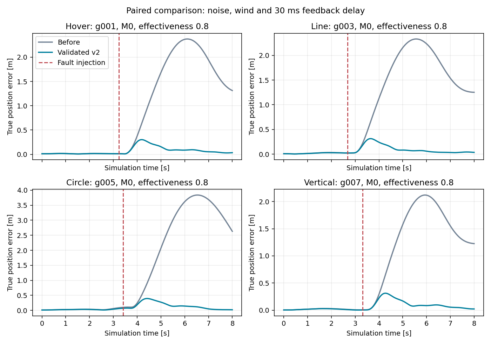
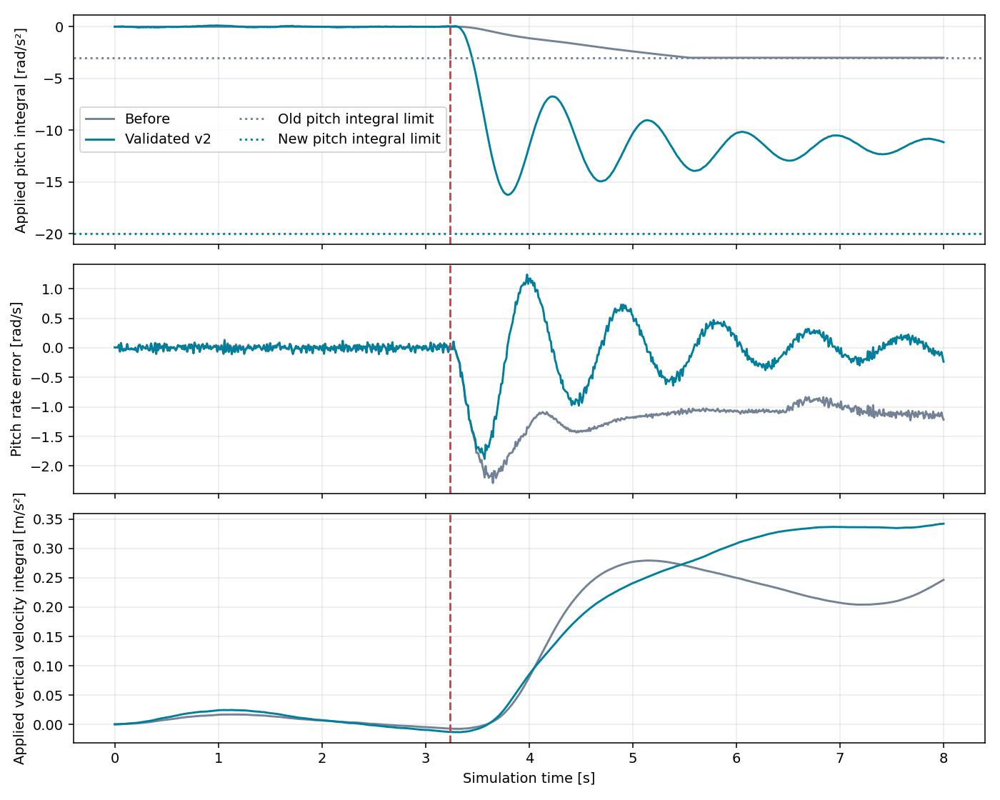
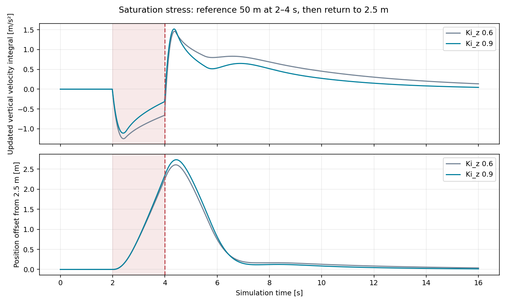

# 积分整定实际验证报告

## 已启用的控制参数

从 `f44cdbc` 固定基线开始，开始于2026-10-10，后续验证于2026-10-11完成。
模型版本为 `hex_research_v2_integral_recovery`，参数文件 `hex_research/configs/research.json`。

| 参数（横滚/俯仰/偏航或x/y/z） | 修改前 | 本轮启用 |
| --- | --- | --- |
| `rate_i` | [1,1,0.6] | **[30,30,0.6]** |
| `rate_integral_limit_rad_s2` | [3,3,2] | **[20,20,2]** |
| `velocity_i` | [0.4,0.4,0.6] | **[0.4,0.4,0.9]** |
| `velocity_integral_limit_m_s2` | [2,2,2] | [2,2,2] |

位置、姿态、速度/角速度P/D、偏航积分、分配优先级、传感器、风、动力学及六电机编号保持原值。
控制器保留状态反馈与任务参考接口，没有注入故障真值、故障电机编号或网络预测。
抗饱和方程没有重写；控制器和导出器只增加审计日志，旧控制算法与新增日志版本的配对短轨迹逐位一致。

## 按顺序进行的对照

1. 基线43项检查通过。新增日志后47项通过，增加旧输出保护检查且启用最终参数后48项通过。
2. 9个角速度积分候选×2种悬停条件，共18项。只改增益或只改限幅仍失败。
   用户候选 `[10,10,6]/[20,20,20]` 理想条件RMSE0.2371m、最终误差0.0958m；
   30ms延迟含噪风反馈最终误差0.1046m，超出0.10m，失败结果保留。
3. 四类任务、M0/M1、理想/30ms延迟条件筛选，共48项。
   旧参数0/16通过，RP积分20候选16/16，RP积分30候选16/16；选择后者再做完整验证。
4. 保持原外环时，32健康+192轻微故障+64长期检查全部通过。
   补充16秒总推力饱和恢复试验发现竖直速度积分尚有0.135m/s²，未达到提前设定的0.10要求。
5. 固定内环、仅比较竖直速度积分0.9和1.2。两者均通过两项饱和/恢复试验，选择测试中较小的0.9。
   对最终完整配置重新执行全部32+192+64项检查，没有沿用上一候选的通过结论。

原内环候选结果：`rate_only_validation_summary.json`、`rate_only_long_summary.json`。
最终结果：`validation_summary.json`、`long_summary.json`、`velocity_selection.json`。
新参数及配置哈希见 `PASSED_PARAMETERS.json`、`promotion_receipt.json`。

## 最终完整工况

| 检查 | 实际结果 |
| --- | --- |
| 健康：8任务×4条件 | **32/32通过** |
| 单电机效能0.8：8任务×6电机×4条件 | **192/192通过** |
| 长时间悬停/任务结束保持 | **64/64通过** |
| 短任务最差位置RMSE | **0.154167m**，原门槛0.25m |
| 短任务最差最终误差 | **0.061088m**，原门槛0.10m |
| 位置门槛最小相对余量 | **38.33%**，达到事先要求的10% |

四种条件、既有八组任务、风与传感器随机流、故障日程严格配对。
0.8为稳态效能，实际转速通过一阶动态变化；不是故障瞬间直接把实际推力乘0.8。
这些检查是研究条件下的离线验证，没有建立实机或未见场景的安全保证。

## 积分与抗饱和检查

旧悬停故障记录的俯仰积分首次在5.54s达到3rad/s²上限，积分限幅采样比例30.84%；
这条记录的名义抗饱和阻止比例为0，因此不能把失败归因于抗饱和阻止积分。
离线稳态计算需要的轴向积分约11.56rad/s²，解释了旧上限不足。
只放宽上限而保留增益1，8秒时最大俯仰积分只有5.25rad/s²，补偿建立仍太慢。

实际偏航速率恢复试验从2rad/s开始，51个采样出现名义积分阻止，所有被阻止的轴积分增量为0；
16秒时偏航积分返回0.00838rad/s²。总推力饱和试验的电机限幅被实际观察到，退出后最后2秒无电机限幅；
速度积分从最大约1.52m/s²收回到0.04482m/s²，最终位置误差0.01366m。
该压力试验在2–4秒请求不可达的50m高度，仅按恢复要求评价，不把其17m全段RMSE当作正常任务精度。
角速度和速度积分限幅、请求/允许/实际增量及使用/更新状态均有独立CSV列。

## 新版数据与诊断状态

控制参数及门槛已通过，接下来在独立 `output_hex_rate_tuning_20261010/release_v2` 生成完整配对记录。
本阶段尚未把新数据或训练结果视为完成；后续交付补充实际生成、完整性和诊断结果。
旧152条数据、旧失败记录和模型保留；新数据不会重新签名覆盖旧来源。

## 保留的失败与限制

- 单因素角速度试验、积分10候选在延迟下的失败均保留。
- 原外环的16秒速度积分恢复未通过结果保留，随后只改Ki_z再复验。
- 补充压力试验首轮JSON写出遇到NumPy布尔类型序列化错误；执行源码、已有轨迹及错误记录在`failed_attempts/`，
  仅修正输出类型并在新目录重跑，没有改控制方程或放宽门槛。
- 参数仍为研究设计。Full/Severe故障分配重构、在线健康估计、实飞和正式学习性能为后续工作。
- 本轮未合并或推送。
