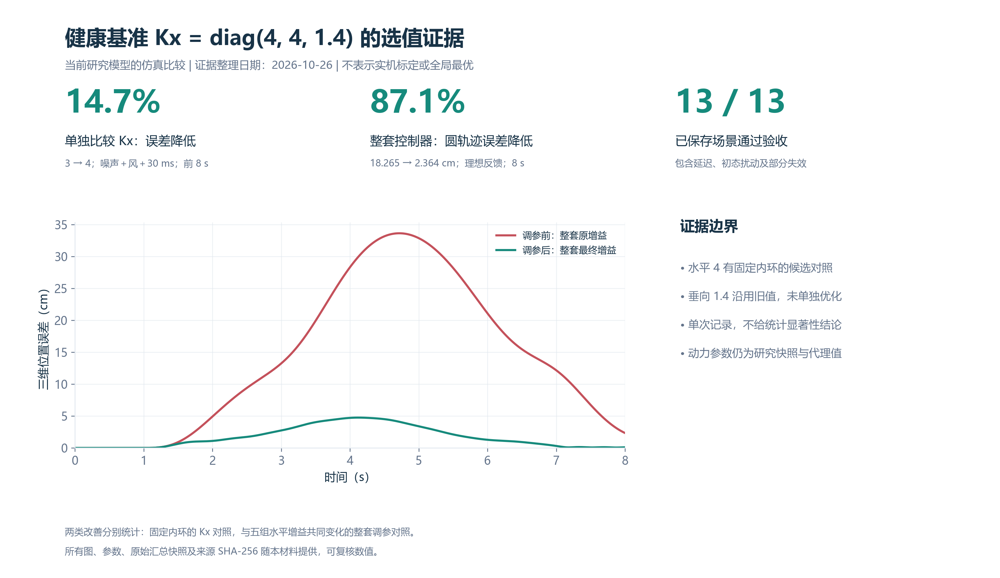
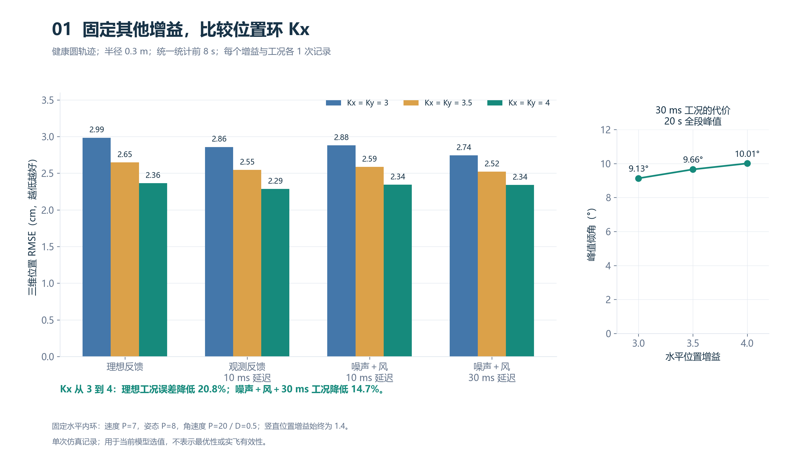
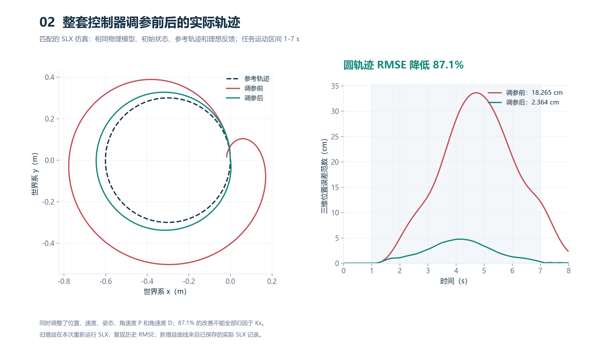
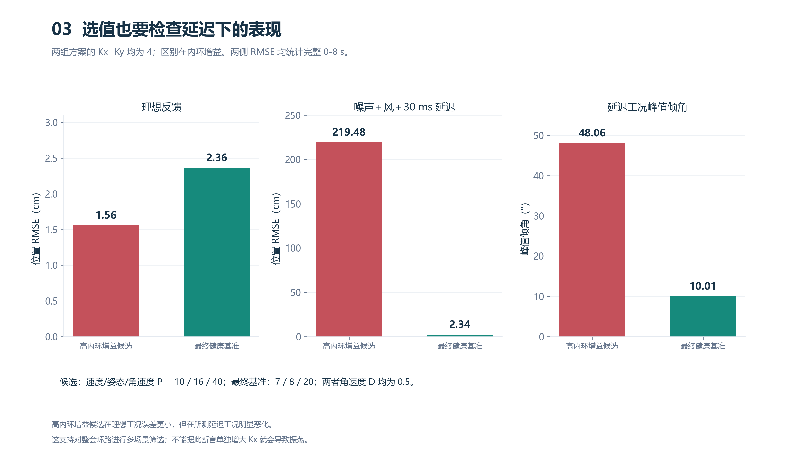
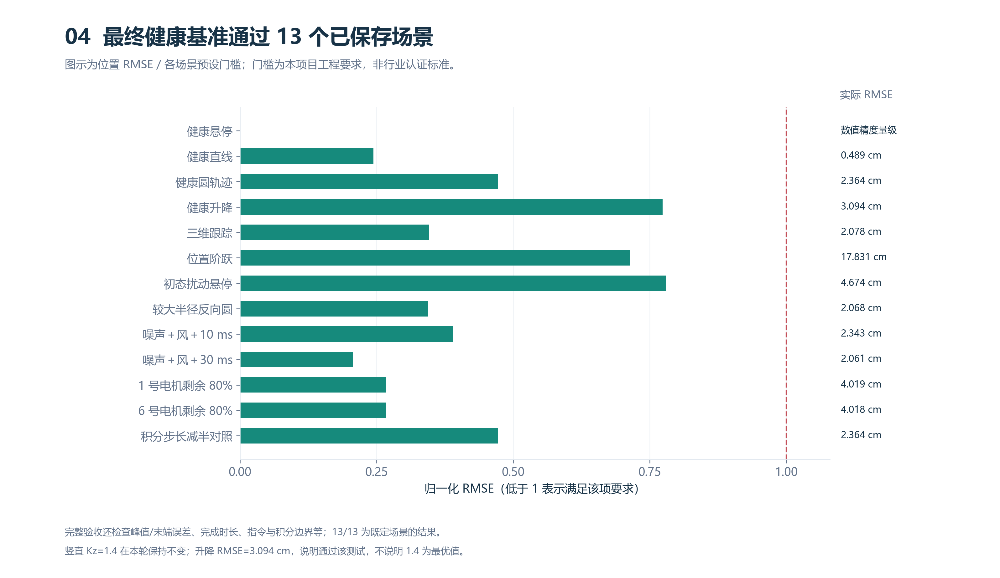

# 健康基准位置增益的仿真选值证据

整理日期：2026-10-26。健康参数版本：`pv_baseline_20261021`。

本材料给出 Kx=diag(4,4,1.4) 在当前研究模型下的仿真依据。水平两个 4 经过候选比较，竖直 1.4 沿用旧值并通过指定升降试验。没有证明全局最优，也没有完成实机验证。

[下载五页 PDF](kx_gain_evidence.pdf)。下方高清图可直接查看，配套 SVG 可用于报告排版。

## 1. 固定其他增益，单独比较位置环

水平速度 P=7、姿态 P=8、角速度 P=20、角速度 D=0.5；所有其他控制参数一致，仅 Kx=Ky 取 3、3.5、4。四种条件均为健康圆轨迹，20 s 试验中统一统计 0-8 s 的三维位置 RMSE。每个组合仅一条已保存记录，不给重复试验置信区间。Kx 从 3 到 4，理想工况误差降低 20.8%，噪声+风+30 ms 工况降低 14.7%。30 ms 工况全段峰值倾角从 9.13° 增至 10.01°，体现纠偏要求与瞬态响应的权衡。

## 2. 整套控制器调参前后

旧增益本次重新运行实际 SLX；新增益使用已保存的实际 SLX。两者都是 8 s 健康圆轨迹，半径 0.3 m，1-7 s 运动，理想反馈、无噪声、无风。时间轴、参考和外部输入完全一致。RMSE 为 18.265 与 2.364 cm，降低 87.1%。

五组水平增益同时变化：位置 P 1.2→4，速度 P 2.5→7，姿态 P 4→8，角速度 P 8→20，角速度 D 0.1→0.5。竖直及偏航增益均不变。因此这项 87.1% 的改善不能全部归因于 Kx。

## 3. 保留延迟表现不佳的候选

两组方案 Kx=Ky 都为 4。高内环候选的速度/姿态/角速度 P 为 10/16/40，最终健康基准为 7/8/20；D 都为 0.5。高内环候选理想 RMSE 更小，但噪声、风和 30 ms 延迟下 RMSE 为 219.48 cm，而最终参数前 8 s 为 2.34 cm，两者均完成完整 8 s。

另一组 [5,12,18,45,0.6] 的延迟工况在 3.43 s 提前终止，故未作为完整 8 s RMSE 柱与上述试验混排；失败结果仍保留在 sources/aggressive_candidates.json。该对照说明需要检查内环及延迟，不能据此声称单独增加 Kx 导致振荡。

## 4. 最终参数的多场景验证

13 个已保存 SLX 场景满足预设工程验收，包括健康任务、阶跃、初态扰动、较大圆轨迹、10/30 ms 延迟噪声风、1/6 号电机剩余 80% 效能、积分步长减半。不同场景的门槛不同；它们是项目要求，不是适航或行业认证标准。图只显示 RMSE 项，完整判定同时检查峰值/末端误差、时长、限幅、有限性、积分和四元数约束等。

## 5. 可以与老师这样表述

> 在固定内环参数下，比较了水平位置增益 3、3.5、4 在四种反馈/扰动条件下的响应。Kx=Ky=4 在这些候选中降低了跟踪误差，并通过选定多场景工程验收，因此作为当前研究模型的健康基准。垂直位置增益 1.4 为沿用值，通过指定升降测试；本轮未单独优化，不能声称为最优。

## 6. 数据、复现与边界

- 数值定义：RMSE=sqrt(mean(||实际位置-期望位置||²))，先按每个采样点求三维范数，再做均方根。
- [复算指标](metrics.json)、[来源与 SHA-256](sources/provenance.json)、[固定内环候选](sources/kx_fixed_inner_candidates.json)、[两条轨迹采样](sources/paired_circle_timeseries.json)、[前后参数快照](sources/paired_circle_parameters.json)、[配对检查](sources/paired_circle_checks.json)、[最终验收](sources/baseline_validation.json)。
- 脚本：`simulink/validation/build_kx_gain_evidence.py`。有 sources 快照时可独立重画；添加 `--refresh-sources` 则从本地历史输出重新采集。PDF 环境需 reportlab，绘图环境需 numpy/scipy/matplotlib。
- 本轮绘图未更改控制器、动力学参数或 SLX；35 项既有源文件哈希均复核一致。
- 仿真动力模型仍采用 kT=7.45e-6、Q/T=0.01315 m（代理参数），没有切换成 AIR Gear 355 的成套系数。本材料验证的是该模型中的控制器选值，不证明动力参数真实性。
- 图表采用健康基准的历史 8 s 比较窗口；最新故障恢复入口的 24 s 仿真属于另一组试验。
- 每条曲线和柱形来自单次仿真记录，未提供重复随机种子统计结论或实机测试结论。

PNG 适合直接粘贴，SVG 为矢量图，可用于报告排版。PDF 汇总输出到仓库 `output/pdf/kx_gain_evidence_20261026.pdf`。
