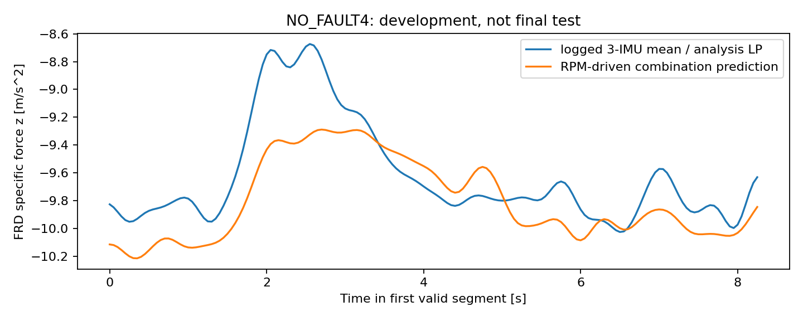
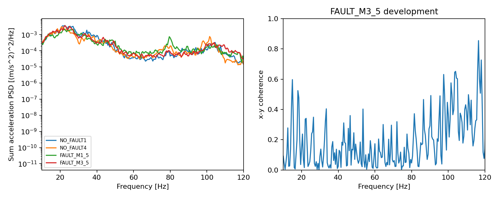
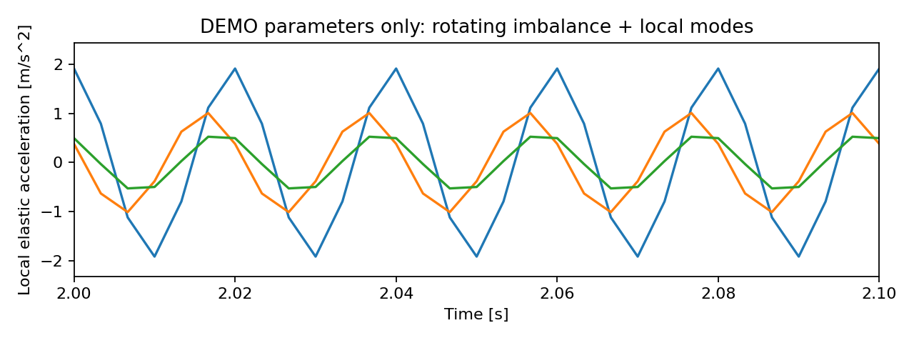

# 实际验证报告

本报告来自实际运行结果，不是计划或预计结果。完整数值、每次代码/配置/数据哈希见 validation_metrics.json；实际数组和图位于 output_uavfd_f550。

## 解析与软件边界

23/23项预定解析检查通过。所有数值参数为demo，不是UAV-FD标定。

检查覆盖静止支撑/比力符号、自由落体、悬停、单桨力矩与反扭矩、已知外力/主轴力矩响应、四元数、旋翼单位转换、IMU离心测点项、一阶执行器阶跃、不平衡离心/切向项与旋向、模态ringdown、积分步长收敛、采样抗混叠与Nyquist拒绝、旧坐标适配。

有机体陀螺耦合的RK4误差（dt=0.1/0.05/0.025s，独立solve_ivp参考）：[2.4815137590311025e-10, 1.538846165977213e-11, 9.582152298479141e-13]。

局部模态旋转强迫输入ZOH的1000→2000Hz、2000→4000Hz比较RMS：[0.0743709952390119, 0.03698386878008927]m/s²。下降约一半符合输入ZOH的一阶误差；不虚报为连续输入高阶精度。

unittest验证MAT字段换序解码、三IMU共同时间戳平均、v7.3/HDF5 cell、重复请求变量拒绝、未知物理参数拒绝和开发/锁定集访问边界。执行记录见checks.txt。

## 正常实飞组合模型

NO_FAULT1–3标定，NO_FAULT4开发；每条飞行同等总拟合权重。2Hz离线处理、1s非重叠短时预测，窗口只作误差汇总，不能当独立重复。

有效竖直系数a=2.4889885e-06，截距b=4.644153m/s²；归一化条件数52.184。大截距提示未分离偏置/遗漏作用/相关性，不报告为真实kT/m。

六组独立平方转速设计条件数161.828，最小/最大奇异值比0.006179；弱相对激励，没有宣称质量、惯量或六组独立推进系数可唯一辨识。每条飞行估计见parameter_ledger/validation_metrics。

| NO_FAULT4指标 | 模型三轴RMSE | persistence三轴RMSE |
| --- | --- | --- |
| 角速度rad/s | 0.156614, 0.171536, 0.273575 | 0.156670, 0.173486, 0.374110 |
| 姿态旋转向量rad | 0.146875, 0.123941, 0.232343 | 0.097696, 0.063615, 0.144900 |
| EKF速度m/s | 0.514785, 1.057594, 0.274104 | 0.477837, 0.677593, 0.295899 |

IMU比力三轴RMSE=[0.28574834700652524, 0.7527926540260683, 0.2894813024365023]m/s²。x/y模型均为零推力方向比力，真实横向作用/测点影响没有恢复。

结果：角速度有有限改善，姿态所有轴以及水平速度未优于persistence；因此当前组合基线尚不能支撑全状态模型通过，更不能声称长时开环或持续闭环稳定。没有靠调大噪声掩盖差异，也未调参反复追求开发记录的通过。

## 振动实飞开发评估

正常基线只NO_FAULT1–3；损伤增量只FAULT_M1_5/FAULT_M2_5；开发NO_FAULT4/FAULT_M3_5。PSD与相干性针对日志IMU，包含其未知定制滤波作用。

两条故障标定原始增量：{'FAULT_M1_5.mat': {'raw_increment': [-7.481297675176699e-16, -2.3274663386487905e-16, -1.2887597865781605e-15], 'nonnegative_increment': [0.0, 0.0, 0.0], 'motor': 1, 'status': 'effective_energy_combination_not_mu_or_modal_gain'}, 'FAULT_M2_5.mat': {'raw_increment': [6.828329344309258e-16, 3.989553303065606e-15, 1.0244184009348947e-15], 'nonnegative_increment': [6.828329344309258e-16, 3.989553303065606e-15, 1.0244184009348947e-15], 'motor': 2, 'status': 'effective_energy_combination_not_mu_or_modal_gain'}}。M1增量为负，非负约束取0仅为模型边界，不代表故障无振动；没有强制故障能量大于正常。

| 开发记录 | 窗数（仍一条独立飞行） | 同速/同压支持内窗数 | 实测1x带能量均值xyz | 预测均值xyz |
| --- | ---: | ---: | --- | --- |
| NO_FAULT4.mat | 20 | 7 | [0.0015398839365858836, 0.00046848438278809053, 0.00040741836313570173] | [0.0010581327910812852, 0.0002012461277174817, 0.0004090386236774669] |
| FAULT_M3_5.mat | 24 | 15 | [0.0006984154940376862, 0.0002340762140481924, 0.00010405021941801544] | [0.0003970029133218273, 0.000559297504279294, 0.0002208398968603011] |

频带能量单位(m/s²)^2，所有RMSE/轴比例/转频区间见validation_metrics。开发主峰中位数约22–23Hz，明显不同于约66–113Hz旋翼转频；不能将最大峰直接归为损伤1x峰。模态与滤波、转速变化、运动工况及多个转频频带重叠共同限制解释。x-y相干性和全谱图已输出，未凭诊断可分性倒推模型准确。

以上均值覆盖本记录所有合格窗口，并非同速同压子集均值；子集误差单列在validation_metrics的common_support_error。正常能量使用Motor1中心带，故障使用标签电机中心带，均不能解释为独立单桨能量。当前120Hz上限未覆盖开发数据的2x及更高阶次；没有据带外缺测断言真实谐波不存在。

结果：实飞频带观测基线可复现，但两个损伤标定位置不能支持统一损伤增益；FAULT_M3_5三轴能量预测有明显偏差。真实mu、结构模态、传感器传递和缺损几何未标定。

## 通过条件、数据预算与下一阶段

分析配置在首次拟合前固定：解析关系采用数值误差阈值；实飞仅报告与persistence的比较，无有依据的整体高保真通过阈值。后续阈值需按研究用途确定。本轮阶段D、大规模造数、诊断网络和最终锁定测试门槛关闭。

预算：3条正常标定+2条故障标定；2条开发用于评价且计入开发预算；11条最终测试仅审计完整性/配置/时间，不读取幅值或频谱。未来real-only比较必须给相同7条开发实飞额度。

未能确定：真实平台/动力/桨型号与5/10几何；整机m/J/COM/IMU位置；分离kT/kQ和mu/传递增益；高速真实相位；执行器及日志延迟；作者定制滤波/混控/控制实现。详见MODEL_STATUS的准确补充资料清单。

## 本轮执行

2026-10-04执行：git status/branch/remote/log/fetch；git switch -c codex/uavfd-f550-model；sources、audit、calibrate、replay、vibration、demo、validate、report；unittest；最终测试入口拒绝检查；受保护工作区哈希复核。命令、退出状态见checks.txt与工作目录运行记录。当日未合并、推送、运行最终分类或解锁测试集。2026-10-05用户授权提交并推送独立分支，代码发布记录以Git历史为准。

## 实际输出图

正常实飞开发记录的比力比较：

日志IMU的PSD与开发记录x-y相干性：

以下仅为demo局部模态演示，不是UAV-FD实飞仿真：

