# V3：去除电机指令与训练时间覆盖独立实验

基线 `f474282d07f9f86de24fcacb6f000b2e09205ef1`。本报告来自已完成的原生 Simulink 采集、实际训练与统一冻结测试；审计通过 436 项。

## 结论与范围

1. 去掉电机指令：相同前24秒训练下，B 相对 A 的完整测试准确率变化 **-42.78 个百分点**，宏F1变化 **-50.72 个百分点**。主实验仅使用12维传感器信号。
2. 只学前6秒：D 相对 B 的故障初期宏F1变化 **+14.24 个百分点**，故障后期变化 **-13.39 个百分点**。短时段模型仍完整评价到24秒。
3. 前12秒：C 的完整24秒测试宏F1为 **45.50 ± 0.62%**，相对 B 变化 **+3.99 个百分点**。根据测试解锁前声明的验证指标，冻结推荐为 **前12秒**；没有依据测试结果重新选择训练时长。
4. 数量与覆盖：D、E 都使用714个原始训练窗口；E 相对 D 的完整测试宏F1变化 **+9.25 个百分点**。这是固定抽样种子的一次等量对照；时间覆盖、抽到的具体运动阶段会同时变化，不能把全部差异唯一归因于某一项。
5. 前6秒增广：所选GAN比例为1，相对逐类同量ROS的完整测试宏F1差值为 **+2.26 个百分点**；三个种子分别为 +7.30、+8.39、-8.91。**未稳定超过同量ROS**。
5. 前24秒增广：所选GAN比例为0.25，相对逐类同量ROS的完整测试宏F1差值为 **+0.01 个百分点**；三个种子分别为 -1.14、+0.72、+0.46。**未稳定超过同量ROS**。

## 数据来源与训练口径

正式使用12个独立配对条件组、228条原始仿真记录：原训练6组114条、原验证3组57条、新测试3组57条。每组为同一随机风与测量噪声条件下的1条健康记录与18条故障记录；独立扰动来源按12组计算，不能把228条记录当成228组独立扰动实验。旧测试3组57条原位保留归档，不参与本轮正式评价。

按不同仿真记录计数，训练为6条健康＋108条故障，验证为3条健康＋54条故障，新测试为3条健康＋54条故障；合计12条健康、216条故障。窗口与增广样本不能加到这些原始记录数量中。

任务保持原绕圈任务，原任务运动时段为第1～7秒，其余时段包含运动前悬停与运动后保持／恢复；因此前6秒训练未覆盖全部任务运动及后段稳定过程。每条仿真24秒，第3秒注入故障，失效效能仍为0、20%、80%。物理模型、PID、容错控制器、随机风、噪声及0.03秒反馈延迟均未修改。所有228条正式记录完整且有限，飞行恢复验收失败的记录数为1；没有因识别困难而删类别或重选测试种子。

保留的未通过飞行恢复验收来源为 `v1_g000_label06`（用途train、条件组0、种子20261103、类别6）。该记录仍完整24秒；验收失败标记保留在来源清单，没有从窗口池剔除。

训练种子42、43、44只控制网络训练与增广抽样，不增加独立飞行来源。新测试风噪种子固定为20261115、20261116、20261117。E组抽样种子固定为731905。

|训练区间|每条健康记录|每条故障记录|每条件组|训练6组|验证／测试3组同时间子集|
|---|---:|---:|---:|---:|---:|
|[0,6)秒|11|6|119|714|357|
|[0,12)秒|23|18|347|2082|1041|
|[0,24)秒|47|42|803|4818|2409|

采样频率100 Hz，采样周期0.01秒；窗口长度100次采样，窗口移动周期0.5秒。窗口例如0.00～0.99秒、0.50～1.49秒；故障记录第一个保留窗口为2.50～3.49秒。窗口标签按末时刻确定，transition／post_fault仅作离线分段标记。原CSV和MAT均保留2401行完整24秒记录。

12维严格来自加速度计、陀螺仪以及feedback_state_14～19。IMU按V2延迟一次，转速反馈已经带噪与延迟，未再次延迟。没有将电机命令、真实转速、效能、故障时刻、控制分配残差或来源信息送入主模型。改变命令与真值列不改变主特征的检查已在实际记录上通过。

E逐来源、逐类别无放回抽取健康11窗及每条故障记录6窗。其StandardScaler与GAN用MinMaxScaler都只拟合真正选中的窗口；没有提前用完整24秒统计量拟合。

所有分类器沿用单头19类LSTM、隐藏维度64、2层、原注意力池化、批量32、Adam学习率0.001，并实际更新1000次。原始D／C／B在采样有放回的训练下，每个训练窗口平均被抽取约44.82／15.37／6.64次；这是固定更新预算下不同重复使用程度，不能解释为相同epoch数。

总计51个分类器任务、51000次分类器更新；6个原类别条件12维WGAN-GP，18000次生成器更新、90000次critic更新。各GAN均完成3000次G与15000次D更新，不使用电机指令条件。所有增广数量为逐类floor(原数量×比例)，具体数量见actual_training_budgets.csv。

## 共同测试范围上的主指标

下表为三个训练种子的均值±总体标准差，单位%。它描述训练随机性的波动；独立测试来源仍只有3个条件组。主指标统一采用19类logits.argmax，与报警阈值无关。

|模型|前6秒准确率|前6秒宏F1|前12秒准确率|前12秒宏F1|完整24秒准确率|完整24秒宏F1|
|---|---:|---:|---:|---:|---:|---:|
|A：18维，前24秒|90.94 ± 2.90|90.55 ± 2.66|93.50 ± 2.02|92.53 ± 2.84|93.55 ± 2.78|92.23 ± 3.82|
|B：12维，前24秒|52.57 ± 2.13|45.20 ± 1.37|51.30 ± 2.06|42.62 ± 1.67|50.77 ± 2.40|41.51 ± 2.64|
|C：12维，前12秒|59.76 ± 0.87|54.77 ± 2.96|54.98 ± 0.28|48.22 ± 1.54|53.23 ± 0.46|45.50 ± 0.62|
|D：12维，前6秒|65.73 ± 0.87|61.04 ± 1.32|49.54 ± 0.92|44.18 ± 1.05|43.06 ± 1.23|36.07 ± 1.79|
|E：12维，全时段等量抽样|54.44 ± 2.30|47.67 ± 1.90|54.02 ± 0.80|46.34 ± 2.00|53.45 ± 1.16|45.33 ± 2.09|

|模型|完整时段正常召回率|故障窗口电机编号准确率|故障窗口严重度准确率|
|---|---:|---:|---:|
|A|95.74|93.42|99.65|
|B|33.33|51.87|88.83|
|C|67.85|52.34|77.63|
|D|99.29|45.28|59.24|
|E|86.76|52.06|75.44|

电机编号与严重度准确率均从同一个19类argmax结果推导，故障被预测为正常时记错；这两项是解释性分解，不替代19类主指标。

一个与现有模型一致的解释是：电机动力学的目标为sqrt(eta)×command，而容错控制器会按1/sqrt(估计eta)补偿命令。补偿接近准确、且执行器未饱和时，不同剩余效能下的实际转速与IMU差异可能缩小，命令仍可能保留补偿幅度信息。这是依据[电机动力学](../../../simulink/functions/hex_derivative.m)和[控制器补偿](../../../simulink/blocks/controller_step.m)作出的机理解释；分类分数下降本身不能证明严格不可辨识，也不能推出实机规律。

|模型|故障初期3～6秒宏F1|中期6～12秒宏F1|后期12～24秒宏F1|
|---|---:|---:|---:|
|A：18维，前24秒|86.70 ± 3.35|88.21 ± 4.18|86.61 ± 5.11|
|B：12维，前24秒|44.79 ± 1.48|40.52 ± 3.13|40.26 ± 3.15|
|C：12维，前12秒|53.19 ± 3.48|42.87 ± 1.09|42.31 ± 0.34|
|D：12维，前6秒|59.03 ± 1.30|32.25 ± 1.80|26.87 ± 2.71|
|E：12维，全时段等量抽样|45.91 ± 1.95|43.06 ± 1.46|42.56 ± 1.33|

分阶段只包含故障记录：初期按窗口末时刻[3,6)秒，中期按末时刻[6,12)秒；后期要求整个窗口起点≥12秒且末时刻<24秒。上表保持固定19类宏F1，因此没有健康样本的阶段即使18种故障全对，固定19类宏F1上限也只有18/19。CSV另列实际出现类别宏F1，以便解释；不将这两种口径混用。逐类召回与非零混淆项均单独保存，未列出的混淆项视为0。混淆矩阵标签中的0%、20%、80%表示剩余推力效能。

## 验证选择与增广比较

比例候选0、0.25、0.5、1.0。每个训练时长、每种方法分别以三个种子的共同完整24秒验证宏F1均值选择；比较值保留8位小数，同分选较小比例。前12秒只做原始数据对照，未因测试结果临时增加GAN。

正式测试包含27个不同权重的入选分类器。最佳ROS与同量ROS若比例相同，复用同一个已训练模型并在表中明确列出；其余比例保留验证结果，不根据测试重新选择。

|训练时长|方法|验证所选比例|完整测试准确率|完整测试宏F1|
|---|---|---:|---:|---:|
|前6秒|原始|0|43.06 ± 1.23|36.07 ± 1.79|
|前6秒|验证最优ROS|1|41.90 ± 4.96|37.41 ± 5.03|
|前6秒|所选GAN|1|45.47 ± 3.39|39.68 ± 3.89|
|前6秒|与GAN逐类同量ROS|1|41.90 ± 4.96|37.41 ± 5.03|
|前24秒|原始|0|50.77 ± 2.40|41.51 ± 2.64|
|前24秒|验证最优ROS|0.25|52.59 ± 0.22|44.23 ± 0.28|
|前24秒|所选GAN|0.25|52.39 ± 0.30|44.25 ± 0.56|
|前24秒|与GAN逐类同量ROS|0.25|52.59 ± 0.22|44.23 ± 0.28|

生成质量按类别、按通道保存分布距离、PSD差异、恒定通道标记、训练样本最近邻和精确／近重复检查。诊断使用每类固定的前32个生成样本，共608个探针，分布参照为共同完整时段验证集；这不是对全部生成窗口的穷尽质量检查。质量评价的原始分类器已完成1000次更新。质量参考可读取训练与验证，但短时段GAN的梯度训练、scaler及最近邻训练参照仅使用前6秒。生成器损失下降不被作为类别正确或增广有效的证据。

## 完整24秒因果报警

报警窗口仍为100次采样，移动周期为0.1秒，共231次判断，覆盖0.99～23.99秒。推理只接受信号窗口，不接收故障时刻；每条记录从头初始化状态，不在第3秒重置。单头故障概率为1减19类softmax的正常概率，定位类别取18类故障输出的最大值。

阈值0.1～0.9与持续次数2／3／5均逐模型、逐种子通过完整24秒验证记录选择，沿用V2目标函数及状态机。故障前已激活且持续到故障后的报警不作为新检出。正常曝光只统计每组唯一健康记录；每种子共69秒有效报警观测（3×23秒），没有重复累计18条故障记录的健康前缀。因果窗口形成前0～0.99秒不计报警观测时间。

|模型|训练种子|阈值／持续次数|正常误报事件／观测秒数|漏检／54|0.2秒内检出|0.5秒内检出|1秒内检出|3秒内检出|首次定位准确率|首次正确定位覆盖率|最终正确定位覆盖率|
|---|---:|---|---|---|---:|---:|---:|---:|---:|---:|---:|
|A|42|0.9／2|0／69|0／54|0.0%|75.9%|100.0%|100.0%|94.4%|94.4%|94.4%|
|A|43|0.8／5|1／69|0／54|0.0%|0.0%|87.0%|100.0%|87.0%|87.0%|100.0%|
|A|44|0.9／5|3／69|0／54|0.0%|0.0%|92.6%|100.0%|100.0%|100.0%|100.0%|
|B|42|0.9／2|0／69|17／54|0.0%|66.7%|66.7%|68.5%|75.7%|51.9%|57.4%|
|B|43|0.9／3|0／69|18／54|0.0%|44.4%|66.7%|66.7%|80.6%|53.7%|53.7%|
|B|44|0.9／2|0／69|18／54|0.0%|66.7%|66.7%|66.7%|75.0%|50.0%|55.6%|
|C|42|0.9／2|0／69|18／54|0.0%|66.7%|66.7%|66.7%|100.0%|66.7%|66.7%|
|C|43|0.9／3|0／69|18／54|0.0%|55.6%|66.7%|66.7%|100.0%|66.7%|66.7%|
|C|44|0.9／2|0／69|17／54|0.0%|66.7%|66.7%|68.5%|91.9%|63.0%|63.0%|
|D|42|0.8／3|3／69|0／54|0.0%|61.1%|68.5%|100.0%|82.6%|70.4%|70.4%|
|D|43|0.8／2|0／69|17／54|0.0%|66.7%|66.7%|68.5%|100.0%|66.7%|66.7%|
|D|44|0.8／2|0／69|14／54|0.0%|66.7%|66.7%|74.1%|92.5%|68.5%|68.5%|
|E|42|0.8／5|16／69|19／54|0.0%|0.0%|27.8%|55.6%|51.4%|33.3%|38.9%|
|E|43|0.8／3|0／69|17／54|0.0%|42.6%|66.7%|68.5%|91.9%|63.0%|64.8%|
|E|44|0.8／2|0／69|18／54|0.0%|66.7%|66.7%|66.7%|94.4%|63.0%|63.0%|
|GAN_24|42|0.9／2|0／69|18／54|0.0%|64.8%|66.7%|66.7%|80.6%|53.7%|53.7%|
|GAN_24|43|0.9／2|0／69|18／54|0.0%|66.7%|66.7%|66.7%|75.0%|50.0%|50.0%|
|GAN_24|44|0.9／3|0／69|14／54|0.0%|66.7%|66.7%|74.1%|80.0%|59.3%|59.3%|
|GAN_6|42|0.9／2|0／69|18／54|0.0%|66.7%|66.7%|66.7%|100.0%|66.7%|66.7%|
|GAN_6|43|0.9／5|3／69|0／54|0.0%|0.0%|66.7%|100.0%|73.6%|72.2%|72.2%|
|GAN_6|44|0.9／5|4／69|1／54|0.0%|0.0%|75.9%|98.1%|81.6%|74.1%|74.1%|
|ROS_24|42|0.9／2|0／69|16／54|0.0%|66.7%|66.7%|70.4%|91.7%|61.1%|61.1%|
|ROS_24|43|0.9／2|0／69|18／54|0.0%|63.0%|66.7%|66.7%|75.0%|50.0%|50.0%|
|ROS_24|44|0.9／2|0／69|18／54|0.0%|66.7%|66.7%|66.7%|88.9%|59.3%|61.1%|
|ROS_6|42|0.9／5|7／69|0／54|0.0%|0.0%|79.6%|100.0%|76.9%|74.1%|74.1%|
|ROS_6|43|0.9／5|8／69|0／54|0.0%|0.0%|83.3%|100.0%|70.4%|70.4%|75.9%|
|ROS_6|44|0.8／5|4／69|6／54|0.0%|0.0%|74.1%|88.9%|74.5%|64.8%|68.5%|
|ROS_matched_GAN_24|42|0.9／2|0／69|16／54|0.0%|66.7%|66.7%|70.4%|91.7%|61.1%|61.1%|
|ROS_matched_GAN_24|43|0.9／2|0／69|18／54|0.0%|63.0%|66.7%|66.7%|75.0%|50.0%|50.0%|
|ROS_matched_GAN_24|44|0.9／2|0／69|18／54|0.0%|66.7%|66.7%|66.7%|88.9%|59.3%|61.1%|
|ROS_matched_GAN_6|42|0.9／5|7／69|0／54|0.0%|0.0%|79.6%|100.0%|76.9%|74.1%|74.1%|
|ROS_matched_GAN_6|43|0.9／5|8／69|0／54|0.0%|0.0%|83.3%|100.0%|70.4%|70.4%|75.9%|
|ROS_matched_GAN_6|44|0.8／5|4／69|6／54|0.0%|0.0%|74.1%|88.9%|74.5%|64.8%|68.5%|

检出延迟分位数与每条记录的原始延迟保存在alarm_per_seed.csv／alarm_per_record.csv；漏检不从检出率分母中排除。首次定位准确率的分母是产生首次定位的记录，首次正确定位覆盖率的分母是全部54条故障。报警阈值下的单窗口分类指标单独保存在alarm_gated_per_seed_metrics.csv；其判定只使用概率阈值，不叠加持续报警次数，未混入主表。

代表误报／漏检图固定选择按任务标识、训练种子、来源编号排序后的首个符合条件案例；全部异常都保留在CSV中，没有用个别图替代总体指标。

### 必须保留的逐种子异常

- `E`，种子42：正常误报16次／69秒，漏检19／54；该异常保留，不用均值掩盖。
- `ros_p6_r1`，种子43：正常误报8次／69秒，漏检0／54；该异常保留，不用均值掩盖。
- `ros_p6_r1`，种子42：正常误报7次／69秒，漏检0／54；该异常保留，不用均值掩盖。
- 零误报并不表示报警可靠：`B`，种子43的正常误报为0，但仍漏检18／54。

alarm_by_severity.csv进一步按剩余效能0／20／80%拆分检出率、早期检出率和定位覆盖率。窗口19类得分与连续报警的用途不同，不能以较高窗口得分或零误报替代完整报警验收。当前12维主模型的分类与漏检表现仍是后续研究要解决的问题，本轮没有通过重新调参或挑选测试来源隐藏这些不足。

## 冻结、审计与使用限制

冻结收据：`0beea688b3d5bdc9ccd9e43d1114b67f3fdb0e0505b1814220207f4bd585f066`；冻结时间 `2026-11-05T04:38:36.599842+00:00`。全部模型、scaler、比例、报警参数和源代码哈希在测试解锁前固定。首次授权读取时间见test_access_receipt.json；测试缓存的身份包含新来源签名、特征、模型权重和scaler哈希。

结论仅适用于当前绕圈任务、仿真模型、固定故障时刻／强度及这3个新测试扰动条件组。训练与测试使用同一动力学和容错控制器，不能推出跨任务、参数失配或实机效果。等量抽样仅使用一个预声明抽样种子；三个训练种子不能替代更多独立飞行条件。

完整原始记录、权重、训练曲线、报警网格、预测缓存及日志保存在项目下 `output_simulink_gan/v3_imu_rpm_prefix_20261105`；当前目录保留便于GitHub审阅的报告、CSV、主要图表与哈希收据。旧V2数据和权重原位保留。

## 图表

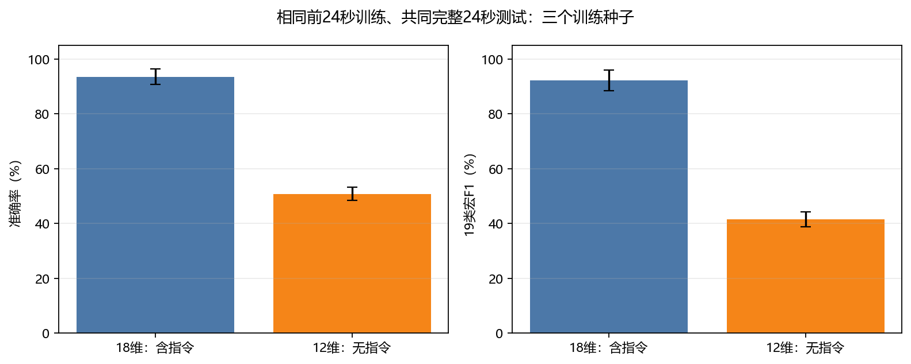

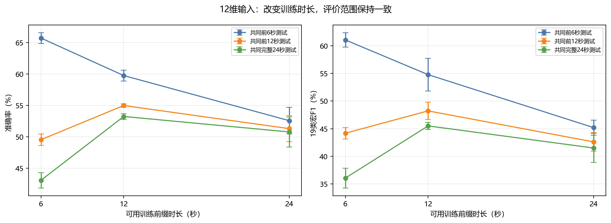

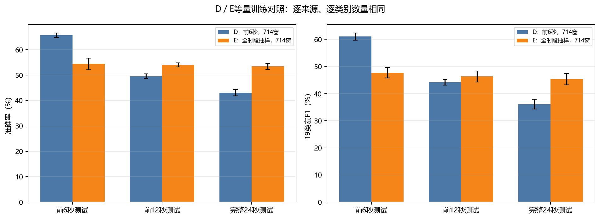

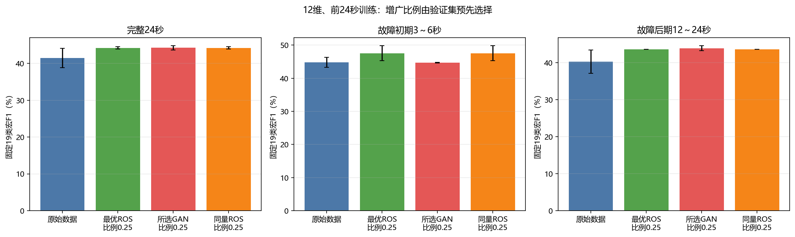

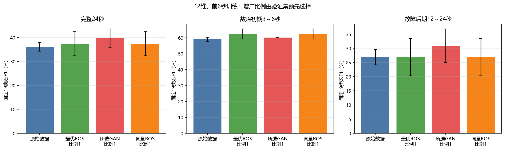

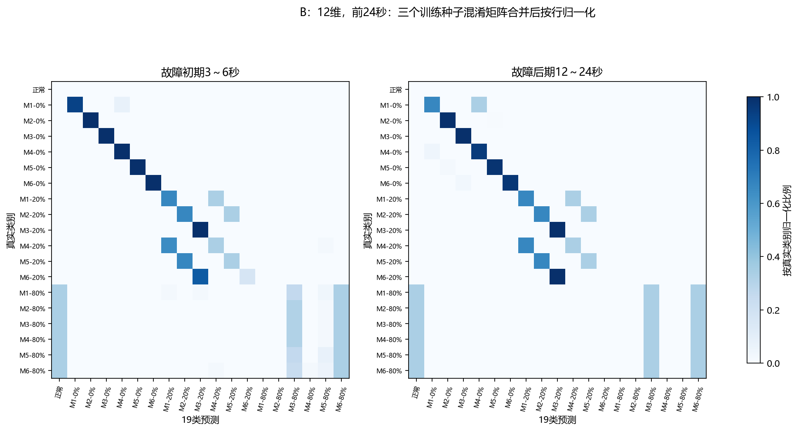

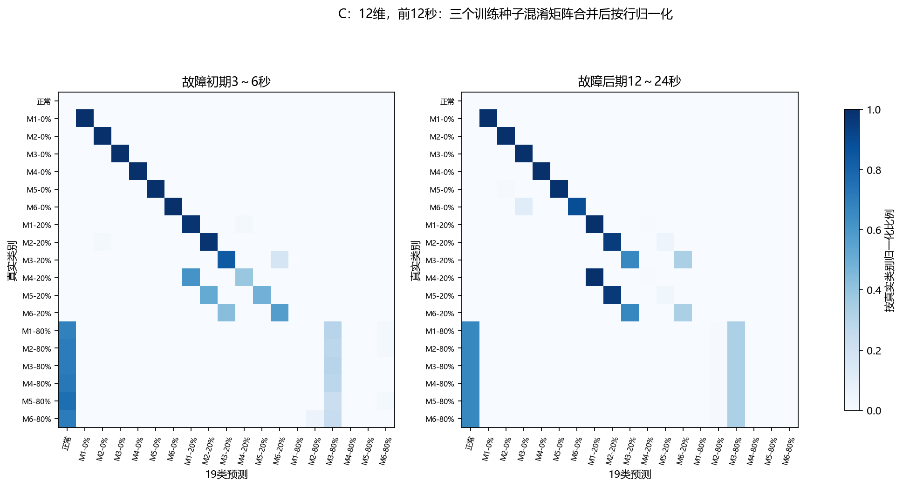

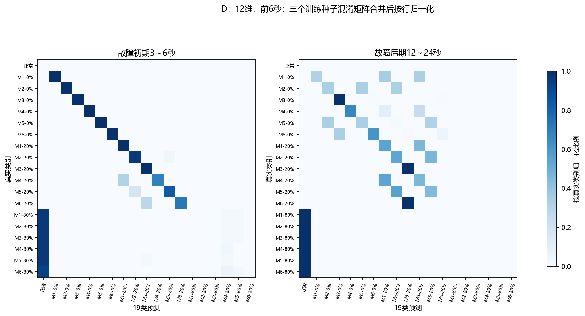

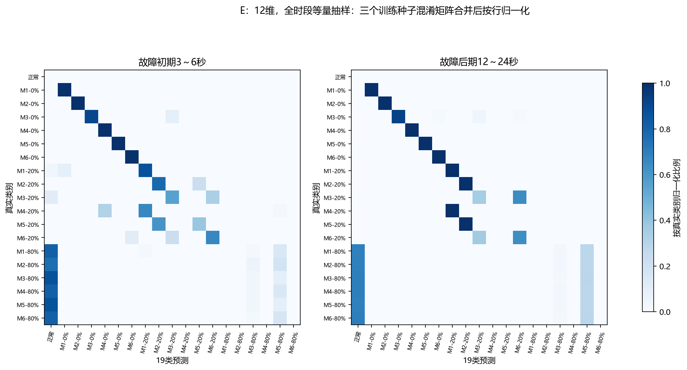

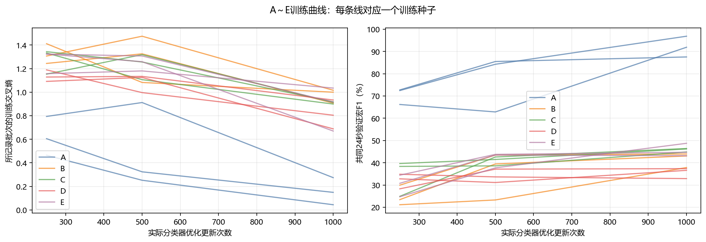

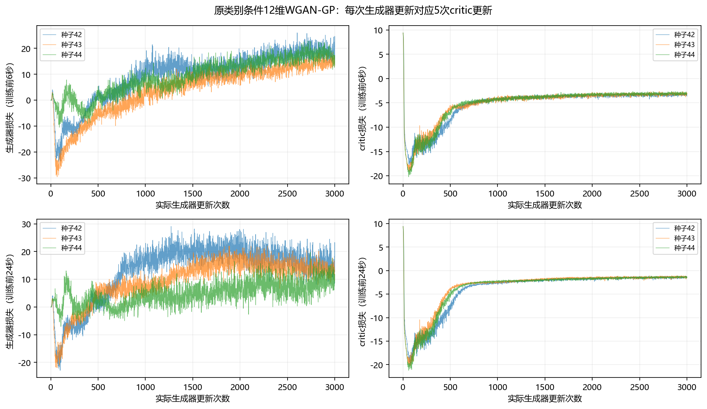

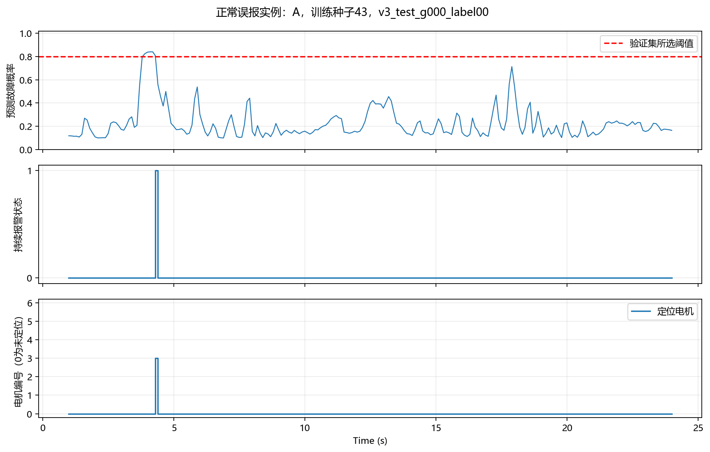

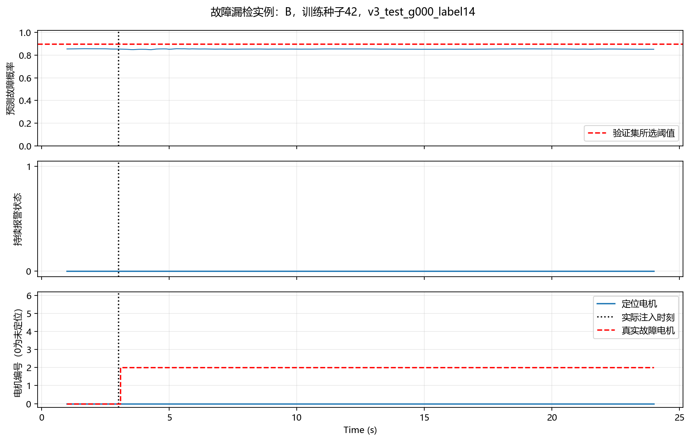

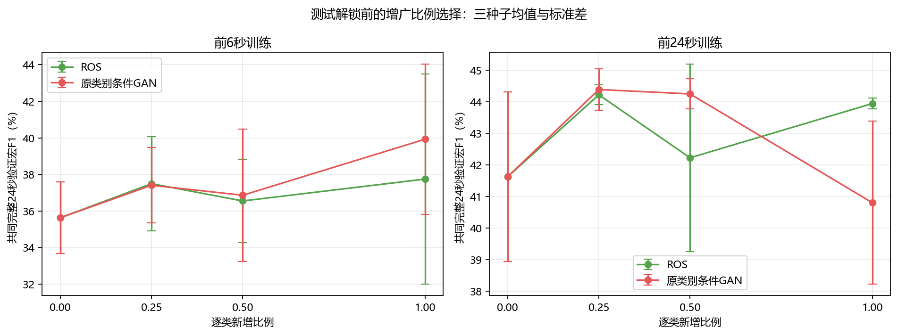

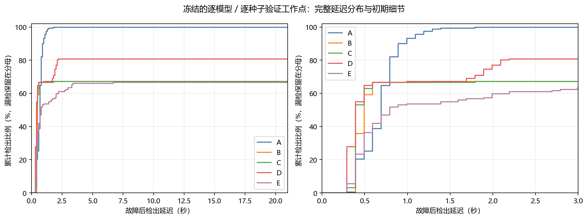
