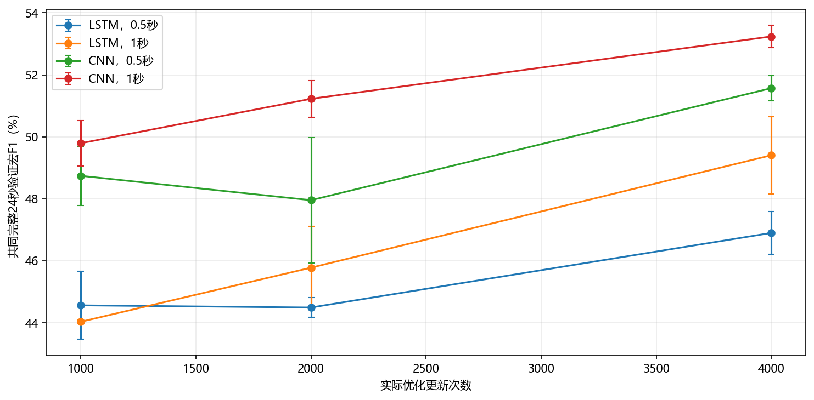
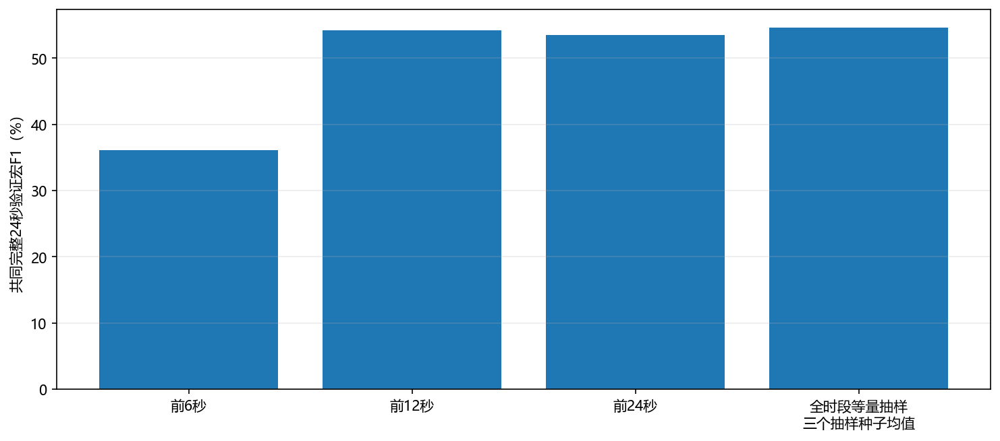
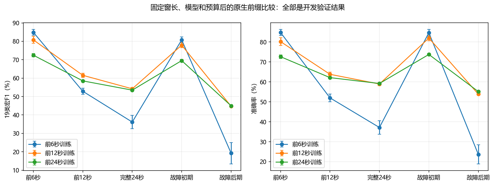
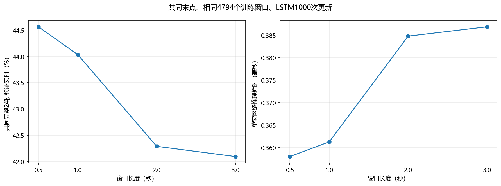

# V4批次A：实际开发结果

**本报告仅含训练／验证结果，未将已曝光V2/V3测试当作新确认。**

基线 `2e033334637be102e9a28c7ce0955d1f7d1f189f`。原始训练6组114条、验证3组57条，原始记录完整24秒。实际完成46条神经训练轨迹、6个统计特征随机森林拟合。

按预登记规则，神经网络研究参考为：**1秒窗口、CNN、4000次更新、前12秒真实训练数据**。

## 窗口与预算证据

|窗口／秒|共同末点LSTM1000步验证宏F1|单窗网络推理毫秒|
|---|---:|---:|
|0.5|44.56%|0.358|
|1|44.03%|0.361|
|2|42.29%|0.385|
|3|42.09%|0.387|

四个长度共用4794训练窗、2397验证窗。此表用于控制末点比较，不直接等同V3原生网格。选定窗口后，在从0秒开始的原生网格上重新训练、重新复核；没有静默复用优化器。

|原生训练前缀|原始训练窗口|完整24秒验证宏F1|
|---|---:|---:|
|前6秒|714|36.14% ± 3.63%|
|前12秒|2082|54.20% ± 0.61%|
|前24秒|4818|53.47% ± 0.41%|

## 学习能力与关键限制

固定152个真实窗口的小样本检查，1000步训练宏F1为67.88%。该检查没有充分记住全部样本；不能据此宣称优化充分或严格不可辨识。

0.5秒共同窗口的随机森林验证宏F1均值为74.13%。它只使用相同12维信号的窗口统计描述，属于单独表示对照；不得忽略其高于神经网络的结果，也不据此证明所有19类都可靠可辨。

1秒共同窗口的随机森林验证宏F1均值为75.43%。它只使用相同12维信号的窗口统计描述，属于单独表示对照；不得忽略其高于神经网络的结果，也不据此证明所有19类都可靠可辨。

4000步是有限预算上限，若曲线仍改善，不称为已充分收敛。等量全时段抽样的三个种子与三个训练种子完整交叉，共九次诊断；不选最好抽样种子，也不增加独立扰动来源。

G1最低非塌缩进入检查：**通过**。该条件只排除零召回或极弱教师，不认证生成标签。后续G1是探索性外部教师约束，必须以独立TSTR、真实验证和直接质量指标另行检查。

## 真实信号分析

来源统计包含171条记录、12通道、五个名义时间阶段；保存均值、波动、变化率、去均值PSD、自相关及通道关联。配对差值与跨条件类内距离分开列出：相同条件的共享风噪会在减法中抵消，因此配对波形有差异不等于在线已有反事实参照。

名义第7秒不保证实际运动完成。source_manifest记录7秒、12秒的实际任务phase；阶段只用于离线分析，不进入网络。完整有限但飞行验收失败的原记录全部保留。

## 状态

批次A已实际完成并冻结共同真实训练池。批次B的实际状态以独立日志为准；新确认测试仍需全部开发选择完成后冻结再解锁。此处不声称GAN收益或新测试成绩。

